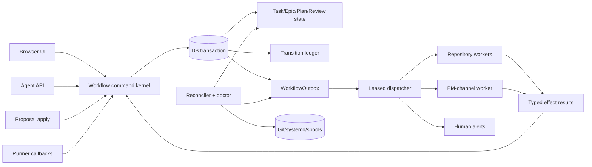

# Mission Control workflow improvement plan

This document is a technical and process improvement backlog for the Mission
Control PM system in `ai/web`. It is based on the current implementation, not
on an idealized workflow. Its goal is to reduce inconsistent states, eliminate
places where an agent must infer a critical outcome, and move repeatable
decisions into deterministic services and scripts.

It is intentionally separate from the current-behavior reference
`ai/web/PM.md`. Nothing in this document should be read as already implemented.

## Executive assessment

Mission Control already has several strong foundations:

- durable canonical work-item and conversation state;
- role-scoped agent workflow tokens;
- repository phase separated from board status;
- linked-worktree validation;
- PM-owned submission commits and finalization;
- local-only Epic-child branches;
- durable PM-channel runs/jobs/stream replay;
- activity records for most important mutations;
- focused contract tests for high-risk boundaries.

The largest remaining source of workflow risk is **policy dispersion**. The same
business rule is partly encoded in UI actions, token endpoints, prompt prose,
queue services, repository runners, and agent instructions. Some paths use the
full gate while authoritative human/bulk/proposal paths intentionally or
accidentally bypass parts of it. This creates a system where the happy path is
safe, but the meaning of a status depends on how it was reached.

The target should be:

```text
Agents and humans express intent.
One workflow kernel validates and records the transition.
Durable workers perform external effects.
Reconcilers prove the recorded state still matches reality.
```

## Guiding goals

1. **One meaning per state.** `Done` should always imply the same completion
   and cleanup invariants, regardless of UI, API, bulk edit, proposal, or
   recovery origin.
2. **Mechanical evidence over declarations.** Derive repository and test facts
   from the worktree/candidate whenever possible.
3. **No critical step depends on agent phrasing.** Plans, checklist steps,
   review outcomes, blockers, and completion evidence should have typed fields.
4. **External effects are recoverable.** Every Git mutation, wake, build, and
   cleanup should have a durable idempotent job and reconciliation path.
5. **The UI explains blocked progress.** A Task should never appear silently
   parked when PM knows the missing approval, worker, wake, branch, test, or
   operator action.
6. **Automation defaults to audit.** Repair tools should be read-only and JSON
   capable by default, with explicit, narrow `--apply` modes.

## Priority map

| Priority | Improvement | Primary risk removed |
| --- | --- | --- |
| P0 | One authoritative transition kernel | Status-path bypass and divergent invariants |
| P0 | Reconcile the Action Plan author/approval contract | Reviewer/assignee ambiguity and stranded plans |
| P0 | Derive repository change state automatically | False `repoTouched:false` bypass |
| P0 | Make role separation universal | Self-review or invalid active-role combinations |
| P0 | Transactional outbox for wakes and runner jobs | Persisted state with lost external work |
| P0 | Required validation profile before Review | Git-valid but untested candidates |
| P1 | Structured Action Plan and PlanStep models | Markdown parser and empty-checklist ambiguity |
| P1 | Enforce implementation and review checklist gates | Premature submit/accept |
| P1 | Candidate lock and revalidation at acceptance | Reviewer approves a moving target |
| P1 | Repository/workflow reconciliation service | Leaked worktrees, stale phases, orphan jobs |
| P1 | Two-phase Epic completion | Epic says Done before branch cleanup/publish proof |
| P1 | Externalize background schedulers | Single-process timer fragility |
| P1 | Durable delivery escalation | Task in Review with sleeping Reviewer |
| P1 | Prevent active role/branch mutation drift | In Progress Task invalidated by editor changes |
| P2 | Explicit Blocked/Waiting state and reasons | Review/To Do used as ambiguous waiting rooms |
| P2 | Project-defined review evidence and templates | Inconsistent agent conclusions |
| P2 | Settings/config drift linting | Runtime and UI policy disagree |
| P2 | Remove legacy APIs and stale prompt text | Agents follow contradictory rules |
| P2 | Workflow metrics and SLOs | Failures noticed only by manual inspection |
| P3 | PostgreSQL/read-scale readiness | SQLite and single-instance growth ceiling |

## P0 — one authoritative transition kernel

### Current problem

There are several entry points for Task movement:

- token-scoped agent workflow;
- board drag/bulk status actions;
- Task editor save;
- work-item proposal application;
- automatic plan/start/queue/review completion;
- repository verifier/finalizer;
- legacy/recovery automation.

The agent `start` path checks approval, blocker, Epic state, role, WIP,
effective-branch collision, and worktree. A browser human move into
`In Progress` ensures a worktree but can bypass the other gates. A native
`ready_for_review` checks open implementation rows; a human Review request
calls the handoff directly and can bypass that checklist gate. Managed
Review → Done uses finalization, while an authoritative direct move to Done
from another column can bypass it.

The result is that `In Progress`, `Review`, and `Done` do not prove the same
invariants on every path.

### Recommendation

Create one typed command service, for example:

```ts
transitionTask({
  taskId,
  expectedVersion,
  intent: "start" | "submit_review" | "request_changes" |
          "accept_review" | "reopen" | "cancel" | "operator_override",
  actor,
  evidence,
  source,
})
```

Every UI action, agent endpoint, bulk operation, proposal apply, and runner
callback should call this service. The service should:

1. load all role, policy, dependency, checklist, Epic, and repository state;
2. resolve the legal edge from an explicit transition table;
3. calculate required side effects;
4. update Task/Epic/repository phase and ActivityLog in one transaction;
5. write outbox rows in the same transaction;
6. return a typed result with blocks, scheduled jobs, and next state.

Do not accept a caller-provided destination column as the main API. Accept
intent; let the kernel decide the status. A human override should be an
explicit `operator_override` with required reason and an audit badge, not an
implicit exemption based only on `actor.kind === "human"`.

### Database reinforcement

- Add `Task.workflowVersion` for compare-and-set concurrency.
- Replace unconstrained status strings with Prisma enums when SQLite migration
  downtime is acceptable, or add database CHECK constraints in a rebuild.
- Add a transition ledger with unique
  `(taskId, workflowVersion, intent)`/idempotency key.
- Prevent `Done` while a repository run is not `completed`, except an explicit
  no-repository contract.
- Prevent `Review` while a repository run is `validating` or
  `action_required`.

### Acceptance

The same test vector must produce the same result through board drag, editor
save, bulk edit, agent endpoint, proposal apply, and runner callback.

## P0 — make the Action Plan contract unambiguous

### Current contradictions

Current web notification code permits an explicitly assigned Reviewer to write
a reviewer plan for an unassigned Task. The fleet-wide `WORKFLOW.md` says a
Reviewer never authors a Task plan and should first assign a coding agent.
Related implementation behavior is also split:

- `assign_after_plan_approval` actually allows assignment before approval;
- `approve_plan` may auto-assign in the same request, making the named follow-up
  action unnecessary;
- automatic reviewer wake after a chat reply fires only when the replying
  agent is the assignee;
- automatic checklist extraction requires an assignee and reads the assignee's
  latest plan, so a reviewer-authored unassigned plan creates no checklist;
- the action name implies an approval precondition that its code does not
  require.

This is a process deadlock risk, not merely documentation style.

### Recommended policy

Use one simple contract:

1. A Task implementation plan is always owned by the eventual assignee.
2. A Reviewer on an unassigned Task uses `assign_task` to select or request an
   eligible worker.
3. The assignee posts the plan.
4. The resolved Reviewer/reporter approves it.
5. Approval may auto-start if all gates pass.

Rename `assign_after_plan_approval` to `assign_task` and make its permitted
states/preconditions explicit. Remove reviewer-plan instructions from create,
edit, bulk-role, and notification prompts.

If the product intentionally wants reviewer-authored plans, model that as a
different typed artifact (`planType:"reviewer_brief"`) and require the assignee
to accept/convert it into an implementation plan before start. Do not overload
the same chat row and approval stamp.

### Required tests

- assigned Task plan wakes correct reviewer;
- unassigned Task cannot approve an absent implementation plan;
- assigning an assignee causes exactly one plan request;
- changing assignee invalidates the plan and checklist or explicitly transfers
  them with human confirmation;
- approval cannot exist without an active plan version;
- approved plan always has a deterministic checklist/waiver outcome.

## P0 — derive `repoTouched` instead of trusting it

### Current risk

The assignee can send `repoTouched:false`. PM then skips branch verification and
moves directly to Review. Finalization later checks cleanliness and start SHA,
which catches many false declarations, but the Reviewer may already have spent
time reviewing an incorrectly classified submission, and non-standard paths
may not reach that check.

### Recommendation

Treat the client field as a hint only. At submission:

1. load the registered worktree and stored `baseSha`;
2. inspect `git status --porcelain=v2`;
3. resolve HEAD and `git diff --quiet <baseSha>...HEAD`;
4. account for staged, unstaged, untracked, and committed changes;
5. classify mechanically:
   - no changes and HEAD == base ⇒ no-change;
   - any diff/commit/untracked file ⇒ code-change;
   - unavailable evidence ⇒ operational error, never no-change.

If the agent's declaration differs, record a warning/audit event and use
measured reality. Remove `repoTouched` from the model-visible decision surface
once migration is complete.

For non-code projects, store an explicit repository contract of
`repositoryRequired:false` rather than infer it repeatedly from a nullable path.

## P0 — enforce role separation on every mutation

### Current risk

Some automated assignment paths exclude the Reviewer, Epic manager, and
reporter. Generic human/bulk role changes primarily validate active principals
and prevent only an agent actor from assigning itself. That can still create
`assigneeId === actingManagerId` or mutate roles on active work without
reconciling approval and repository ownership.

### Recommendation

Create `validateTaskRoles` and call it from create, edit, bulk, proposal, queue,
and migration/recovery code. Enforce:

- implementation assignee is an active coding agent for code work;
- Reviewer cannot equal assignee;
- configured policy may also forbid reporter or Epic manager as assignee;
- deactivated principals cannot remain on actionable work;
- project/Epic allow-lists are applied consistently;
- a role mutation on `In Progress`, `Review`, or `finalizing` is rejected, or
  becomes a formal “return to planning” transition that reconciles approval,
  checklist, session bindings, worktree, and candidate.

Add a uniqueness-like invariant test rather than relying on picker filtering.

## P0 — transactional outbox for all external effects

### Current risk

PM uses durable database jobs for channel turns and filesystem spools for Git
runners. Some state mutations and spool writes happen in separate operations.
A crash can leave:

- state changed but no wake/job;
- a spool file with stale database state;
- a result file whose caller timed out;
- a run marked retryable without an operator-visible escalation;
- duplicate work where file and DB dedupe rules differ.

### Recommendation

Add a single `WorkflowOutbox` table:

```text
id, aggregateType, aggregateId, aggregateVersion,
effectType, payload, status, attempts, availableAt,
claimedAt, completedAt, dedupeKey, lastError
```

Write Task/Epic changes, ActivityLog, and outbox effects in one database
transaction. A dispatcher converts outbox rows into:

- PM-channel jobs;
- repository claim/verify/finalize/cleanup jobs;
- board events;
- web push;
- operator alerts.

Workers must acknowledge the outbox row with a result and idempotency key.
Filesystem spools may remain as the privilege boundary, but should be a
projection of a durable DB job, not the only job record.

Use leases with expiry rather than one-way `.running` filenames. A reaper can
reclaim abandoned jobs safely.

## P0 — deterministic project validation profiles

### Current risk

The repository verifier proves ancestry, cleanliness, prefix, identity, and
publication. It does not run the application tests or prove acceptance
criteria. Review quality therefore depends heavily on the assignee's and
Reviewer's conclusions.

### Recommendation

Add a versioned `ProjectValidationProfile`:

```json
{
  "install": null,
  "required": [
    {"name": "typecheck", "command": ["pnpm", "typecheck"], "timeoutSec": 180},
    {"name": "workflow-contract", "command": ["pnpm", "test:repository-workflow"], "timeoutSec": 240}
  ],
  "advisory": [
    {"name": "lint", "command": ["pnpm", "lint"], "timeoutSec": 240}
  ],
  "workingDirectory": "ai/web",
  "artifactRules": []
}
```

Commands must be stored as argv arrays, never interpolated shell strings.
The trusted verify runner executes them against the candidate worktree after
the PM submission commit. Store `ValidationCheckRun` rows with command version,
candidate SHA, timestamps, exit code, bounded stdout/stderr, and artifact links.

Required failures block Review. Advisory failures produce
`valid_with_warning`. The Reviewer receives exact evidence and can rerun only
the failed check against the same candidate.

Profiles should support project types without forcing pnpm on every repo.

## P1 — structured Action Plans

### Current risk

The plan is an `AgentChatMessage` interpreted through headings and regexes.
Approval does not require a plan row or parseable step. Up to eight bullets are
copied once, but the plan and checklist are not version-linked. Editing roles
or leaving feedback can make it unclear which plan was approved.

### Recommendation

Introduce:

```text
ActionPlan
  id, taskId, version, authorId, authorRole, summary,
  assumptions, risks, validationPlan, status,
  submittedAt, approvedAt, approvedById, supersedesId

PlanStep
  id, actionPlanId, order, title, details,
  dependencyStepIds, parallelGroup, required, kind
```

Agents submit typed JSON through a plan endpoint. PM renders Markdown for
humans, not the reverse. The short/full response can remain presentation fields.

Approval must reference one immutable plan version. Checklist rows should
reference `planStepId`. Material changes create a new version and invalidate
approval explicitly.

Allow an explicit human “no implementation steps required” waiver with reason
for legitimate non-work Tasks; do not treat parser failure as the waiver.

## P1 — hard checklist and review gates

### Implementation

Before `ready_for_review` require one of:

- at least one implementation step, all complete; or
- an explicit approved empty-checklist waiver.

Apply this gate in the central transition kernel so human Review requests,
agent actions, bulk changes, and proposal paths cannot differ.

Expose native actions:

- `edit_subtask`;
- `delete_subtask`;
- `reorder_subtasks`;
- `convert_subtask_kind`;
- `waive_subtask` with reason.

This aligns the API with the current rejection message that tells agents to
delete or convert stale items.

### Review

Create a `ReviewRun` tied to `candidateSha`. Require:

- at least one review check or an explicit trivial-review waiver;
- all required review rows complete;
- required validation checks passed;
- Reviewer decision attached to the current candidate.

Do not infer approval from prose. Retire the `looks good, ship it` phrase after
a compatibility window.

## P1 — lock the reviewed candidate

### Current risk

The Reviewer is told to inspect `candidateSha`, but the attached branch/worktree
can theoretically move between validation and acceptance through a human,
misconfigured tool, or another process.

### Recommendation

At review wake:

- store immutable `candidateSha` and `candidateTreeSha`;
- make the Task worktree read-only to coding-agent identities while in Review
  if host ACLs permit;
- verify worktree HEAD equals candidate before every review command wrapper;
- at `review_done`, fetch/re-read and prove local/remote candidate still equals
  the ReviewRun candidate;
- invalidate the ReviewRun and return to validation if it changed.

Reviewer commands should run through a read-only helper that prints the locked
candidate and refuses mutations. Avoid relying only on prose saying “do not
edit.”

## P1 — workflow and repository reconciliation

Build a periodic reconciler that compares database intent with Git and runner
reality.

### Examples of invariant checks

| PM state | Required external state |
| --- | --- |
| In Progress / repository required | registered worktree, expected branch, common repo, `phase=active` or `validating` |
| Validating | one live verify job or a non-expired lease |
| Review / code change | `phase=review_ready` or `finalizing` and candidate exists |
| Finalizing | one finalize job/lease and Task still Review |
| Done / repository required | `phase=completed`, reviewed SHA present, no local Task worktree/branch |
| Epic Done | published Epic branch and cleanup success/pending state visible |
| Agent workflow notify | durable run/job or terminal dispatch failure with escalation |

The reconciler should classify:

- healthy;
- transient/in flight;
- action required;
- safe automatic repair;
- unsafe/operator decision.

It should never delete a branch merely because the DB says Done. Deletion still
requires ancestry/candidate proof.

## P1 — two-phase Epic completion

### Current risk

The normal final Task now completes only after per-Task finalization, which is
good. Epic status can still become Done before the asynchronous Epic cleanup
and final publication check completes. Cleanup may move the Epic back to Review
on publish failure.

### Recommendation

Represent completion explicitly:

```text
Epic delivery status: In Progress → Finalizing → Done
Epic repository phase: merging → publishing → cleaning → completed
```

If adding a board column is undesirable, keep the Epic visually in
`In Progress`/`Review` with a “finalizing” badge until publication and cleanup
are confirmed. Only then write `Done`.

Store an `EpicRepositoryRun` rather than infer Epic cleanup from Task activity
comments. It should hold branch, candidate set, published SHA, cleanup result,
attempt, and last error.

## P1 — externalize background schedulers

### Current risk

`instrumentation.node.ts` runs channel draining, deployment polling, merge
polling, registry sync, auto-archive, and bin purge in the Next.js process.
Global variables prevent duplicates only inside one process. A restart resets
timers; multiple web instances would duplicate them.

### Recommendation

Move periodic responsibilities to explicit services/timers:

- `pm-channel-worker.service`;
- `pm-deployment-watcher.service`;
- `pm-maintenance.timer`;
- `pm-agent-sync.timer`;
- `pm-workflow-reconcile.timer`.

Each command should:

- take a DB-backed lease or host lock;
- perform one bounded drain/poll;
- emit structured JSON;
- exit with meaningful status;
- be safe to run again.

The web process should bootstrap only request-serving prerequisites.

## P1 — delivery escalation and reviewer awakening

### Current risk

A validated Task can move to Review even if no active agent Reviewer exists or
PM-channel dispatch fails. That is preferable to corrupting repository state,
but the Task can silently wait.

### Recommendation

Add a delivery policy:

1. Reviewer wake job is part of the transition outbox.
2. Retry transport failures with bounded exponential backoff.
3. If target is missing/inactive/human, mark `reviewAttentionRequired` with a
   reason immediately.
4. If an agent wake is not accepted by an SLO, notify the reporter/owner by web
   push and surface a board badge.
5. Allow a safe “re-wake Reviewer” action that reuses current candidate and
   does not create duplicate review state.
6. Record accepted, first-stream, decision, and completion latencies.

The same pattern should cover assignee plan/start/feedback wakes.

## P1 — freeze active Task contracts

Once a Task is In Progress or later, changing these values can invalidate the
worktree or review:

- project/repository;
- Epic;
- assignee;
- Reviewer;
- branch;
- commit prefix;
- blocker;
- Git identity and PR target settings.

Reject these edits during active phases by default. Provide one explicit
“return to planning and change contract” operation that:

1. cancels outstanding jobs;
2. invalidates candidate/review;
3. returns to To Do or Backlog;
4. releases or quarantines the old worktree safely;
5. clears/reversions plan approval as required;
6. applies new roles/settings;
7. re-notifies the correct actors.

## P2 — explicit waiting and blocker semantics

`Review` should mean completed work awaiting judgment, not “waiting for an
answer.” `To Do` currently carries ready, blocked, waiting-for-plan, waiting-
for-worker, and returned-feedback cases.

Add a structured `TaskBlock` or `waitingReason`:

```text
blocked_by_task
awaiting_plan
awaiting_plan_approval
awaiting_assignee
awaiting_human_decision
worktree_action_required
validation_operational_error
reviewer_delivery_failed
finalization_operational_error
```

Keep board columns simple but display the reason, owner, since-time, next
automatic retry, and available action. Clear reasons mechanically when the
condition changes.

## P2 — make review evidence a first-class artifact

Create a standard Review summary generated from structured data:

- approved plan version and completed steps;
- candidate SHA/tree;
- changed-file summary;
- required/advisory check results;
- migration/env/restart declarations;
- assignee completion note;
- semantic warnings;
- Reviewer checklist and decision;
- finalization result.

Agents fill typed gaps but do not manually reproduce facts PM can derive.
The durable summary should be visible on the Task and exportable for a human PR.

## P2 — settings and runtime drift control

### Problems to detect

- project/workspace/system inheritance resolves an unexpected value;
- repository path points at a worktree instead of primary checkout;
- PR target or production branch does not exist;
- Git identity is incomplete;
- protected branches collide with effective task/Epic branches;
- more or fewer than one Monitor Agent is active;
- token maps and registry rows disagree;
- service WorkingDirectory points at a stale historical worktree;
- environment examples omit runtime variables;
- deployment helper installed version differs from active worktree code.

Add a Settings “effective value + source” report and a CLI lint. Refuse plan
approval for a repository Task when the repository contract is already known
to be invalid.

## P2 — retire legacy and contradictory paths

Inventory and remove after telemetry confirms no callers:

- legacy task comment/mention PmEvent builders with no emit sites;
- task ack transition assumptions—the endpoint is now liveness only;
- legacy detached Reviewer worktree cleanup mode;
- outdated prompt instructions asking assignees to commit/push when PM owns
  submission;
- stale Stage/HOMELAB chronology in technical comments and deployment titles
  where it obscures current behavior;
- dormant child-Task “subtask” language and APIs after the SQLite column is
  safely removed;
- duplicate transition helpers that bypass the kernel.

Generate the action list embedded in agent prompts from the actual workflow
action schema so new actions such as scope negotiation cannot be missing from
the displayed body shape.

## P2 — workflow metrics and SLOs

Track at minimum:

| Metric | Why |
| --- | --- |
| plan requested → plan posted | Planning responsiveness |
| plan posted → approved | Reviewer/reporter bottleneck |
| approved → In Progress | Worker/worktree availability |
| start claim failure rate | Repository contract health |
| In Progress duration and checklist staleness | Stuck work |
| ready request → validation terminal | Runner health |
| Review wake → accepted/streaming/decision | Reviewer delivery and latency |
| review rounds per Task | Quality/rework |
| acceptance → finalization terminal | Cleanup/publish health |
| Done with leaked worktree/branch | Invariant breach |
| Epic final Task → cleanup completed | Epic close latency |
| outbox oldest age/retry count | Lost external effect |

Define alerts on invariant breaches and queue age, not only service uptime.

## Automation toolkit

The following tools move repeatable diagnosis away from agent conclusions.
Implement their cores in TypeScript using the same domain modules as the web
app. Thin shell wrappers may set the active worktree/environment and call the
typed executable. Do not build repair logic from ad-hoc `sqlite3` and text
parsing.

### `pm-doctor`

Read-only host health overview:

```text
pm-doctor [--json] [--project <slug>] [--task <key>]
```

Checks:

- database connectivity, migration table, WAL/busy timeout;
- systemd units and active WorkingDirectory;
- one active Monitor Agent;
- agent registry/token-map alignment;
- spool directory ownership/modes and oldest job;
- primary repository/worktree topology;
- runner tool versions/install paths;
- effective project settings and Git identity;
- branch DB/live-switch consistency;
- attachment roots and free space.

Exit codes:

- 0 healthy;
- 1 warnings;
- 2 actionable invariant failure;
- 3 tool/permission failure.

### `pm-task-preflight`

Deterministic answer to “what can this Task do next?”:

```text
pm-task-preflight ENV-123 --intent start --json
pm-task-preflight ENV-123 --intent submit-review --json
pm-task-preflight ENV-123 --intent accept-review --json
```

Output every gate as `pass`, `fail`, or `not-applicable` with machine-readable
codes. The UI and agent workflow response should use the same evaluator.

### `pm-workflow-audit`

Scan all active Tasks/Epics for database-only inconsistencies:

- illegal status edge evidence;
- approval without plan version;
- assignee/Reviewer collision;
- inactive assigned principals;
- open implementation rows in Review/Done;
- open review rows after acceptance;
- repository phase incompatible with board status;
- Done Task without reviewed SHA/completed phase;
- Epic Done with open children;
- stuck waiting reasons and alert flags.

Default read-only; `--json` for monitoring.

### `pm-workflow-reconcile`

Apply only predefined safe repairs:

```text
pm-workflow-reconcile --dry-run
pm-workflow-reconcile --task ENV-123 --apply <repair-code>
```

Examples:

- re-enqueue a missing wake/outbox effect;
- reclaim an expired job lease;
- recalculate a waiting reason;
- return an impossible Review row to To Do;
- mark an operational alert.

Never auto-delete Git refs or invent approval.

### `pm-repository-audit`

Cross-check DB repository runs against Git:

- common repository and primary path;
- deterministic worktree location and registration;
- attached branch and expected identity;
- base/candidate/reviewed SHAs;
- dirty state;
- remote existence policy;
- Epic-child branch metadata;
- candidate containment in Epic branch;
- local/remote branch leaks;
- protected branch collision.

Output a proof packet before suggesting cleanup.

### `pm-repository-reconcile`

Narrow `--apply` operations, each idempotent:

- recreate a missing verify/finalize job;
- reattach a known-safe existing worktree;
- remove a **proven completed** clean Task worktree/local branch;
- remove a leaked Epic-child remote ref only after containment proof;
- quarantine rather than delete ambiguous directories/refs.

Require Task key plus repair code. Never accept a broad repository glob.

### `pm-spool-reconcile`

Compare outbox/DB jobs to filesystem files and runner leases:

- orphan DB job;
- orphan spool file;
- abandoned `.running` file;
- result file whose waiter timed out;
- duplicate dedupe key;
- job for a stale aggregate version.

Safe default repair is requeue/quarantine, not discard.

### `pm-role-audit`

Report:

- assignee equals Reviewer/manager/reporter where forbidden;
- monitor assigned to code work;
- inactive/deactivated principals;
- principals outside project/Epic pools;
- active Task role changes after candidate creation;
- unassigned actionable work with an available pool worker.

### `pm-settings-lint`

Render every effective setting and source:

```text
git.name = Zeh Ferrari        source=system
git.email = ...               source=project
deploy.prTarget = main        source=workspace
repository = /srv/Code/...    validation=primary-checkout
```

Add `--strict-repository` for plan/start/review preflight.

### `pm-doc-inventory`

Generate/check:

- App Router pages and APIs;
- Prisma model list;
- workflow action enum;
- repository phase enum;
- package commands;
- systemd/deploy artifact list;
- environment variables referenced in code but absent from examples;
- dead doc links and stale named actions.

Use generated blocks or CI snapshots so technical docs do not drift into old
ticket chronology again.

## Automation design rules

Every operational tool should follow these rules:

- read-only by default;
- `--json` output with stable codes;
- explicit Task/Epic/project scope;
- `--apply <named-repair>` rather than generic mutation;
- idempotent and safe after interruption;
- database lease or host lock for mutation;
- same domain functions as web/API;
- ActivityLog/outbox evidence for every applied repair;
- bounded output and secrets redaction;
- no shell interpolation of database/user values;
- no deletion without Git ancestry and exact path validation;
- tests using temporary repositories and SQLite databases.

Install recurring read-only checks as systemd timers. Alert only on state change
or an aging threshold to avoid notification noise.

## Target architecture



This keeps decisions in the kernel, effects in workers, and proof in the
reconciler.

## Suggested schema additions

| Model/field | Purpose |
| --- | --- |
| `Task.workflowVersion` | Optimistic transition concurrency |
| `Task.waitingReason` / `waitingSince` | Structured blocked/waiting UI |
| `WorkflowTransition` | Immutable intent/from/to/actor/policy/evidence ledger |
| `WorkflowOutbox` | Transactional durable effects |
| `ActionPlan` / `PlanStep` | Versioned typed planning |
| `SubTask.planStepId` / `waivedAt` / `waiverReason` | Checklist provenance and explicit exceptions |
| `ReviewRun` / `ReviewCheck` | Candidate-bound review evidence and decision |
| `ValidationProfile` / `ValidationCheckRun` | Project commands and results |
| `EpicRepositoryRun` | Epic merge/publish/cleanup state |
| `RepositoryJob` | Durable lease/result independent of spool projection |
| `DeliveryEscalation` | Reviewer/assignee wake retries and owner alert |

Avoid adding fields that duplicate facts derivable cheaply from these models.

## Test strategy

### Transition matrix

Generate tests from the legal intent table across:

- actor role;
- current status;
- approval;
- blocker;
- parent Epic state;
- checklist state;
- repository required/phase;
- project policy;
- active role validity;
- WIP and branch collision.

Run the same matrix against every adapter, not just the kernel.

### Repository state machine

Use disposable Git remotes/worktrees for:

- new and existing standalone branches;
- local-ahead/behind/diverged Epic branch;
- leaked remote child branch;
- dirty/clean/no-change worktree;
- candidate changed after validation;
- finalization interruption at every step;
- cleanup permission failure;
- idempotent retry.

### Delivery

Test crash points:

- after transaction before dispatch;
- after spool projection before claim;
- after effect before acknowledgment;
- after callback before run settle;
- agent accepted but never streams;
- human/inactive/missing Reviewer;
- duplicate callback/outbox delivery.

### Documentation contracts

CI should compare documented actions/statuses/phases/env variables with
generated code inventory. A contradiction should fail the documentation check.

## Rollout plan

### Phase 0 — freeze and observe

- Add metrics for every current mutation path.
- Inventory all callers of status/role/repository functions.
- Add read-only `pm-doctor` and `pm-workflow-audit`.
- Reconcile the agent-facing Reviewer-plan and commit-ownership prose
  immediately.

### Phase 1 — centralize without changing UI

- Build transition kernel behind existing adapters.
- Add workflow version and transition ledger.
- Make all current paths call it.
- Add parity tests before removing old helpers.

### Phase 2 — durable effects and reconciliation

- Add outbox and DB repository jobs.
- Project existing spools from outbox.
- Add leases, reaper, delivery escalation, and repository reconciliation.
- Externalize web-process timers.

### Phase 3 — structured plans, checks, and reviews

- Add ActionPlan/PlanStep and migrate live plans.
- Add validation profiles/results.
- Add ReviewRun/checklist hard gates.
- Replace phrase/Markdown inference after compatibility.

### Phase 4 — strict invariants

- Block unsafe human shortcuts or require explicit audited override.
- Enforce Done/repository DB constraints.
- Introduce two-phase Epic finalization.
- Remove legacy APIs, fields, prompts, and duplicate helpers.

## Success measures

The workflow is materially smoother when:

- zero Tasks are Done with a live Task worktree or non-completed repository
  phase;
- zero Review Tasks lack a current candidate or actionable Reviewer/warning;
- every approved plan references a real immutable plan version;
- every Review request has completed implementation evidence or an explicit
  waiver;
- every accepted review has completed required checks and review steps;
- no Task can assign the same agent as assignee and Reviewer;
- no wake or runner job can be lost between DB commit and external delivery;
- every operational failure becomes a visible waiting reason with owner and
  retry state;
- common recovery is performed by an idempotent named repair, not by an agent
  reasoning from logs and editing state manually;
- documentation action/status/config inventories are generated and remain
  current.

## Specific current inconsistencies to resolve

The following concrete findings should be tracked to closure:

1. Reviewer-plan notifications in Task create/edit/bulk code conflict with
   `ai/openclaw/WORKFLOW.md`.
2. `assign_after_plan_approval` does not require approval and its name no
   longer describes behavior.
3. Reviewer-authored unassigned plans do not satisfy assignee-filtered
   automatic checklist extraction.
4. Plan approval does not require an existing plan or parseable/waived steps.
5. Native `ready_for_review` checks implementation rows; human Review paths can
   bypass the same gate.
6. Human `In Progress` moves can bypass approval, blocker, WIP, Epic, and branch
   collision checks while still provisioning a worktree.
7. Direct human Done moves outside managed Review finalization can bypass
   cleanup.
8. `repoTouched:false` is accepted from agent declaration rather than derived.
9. Open review sub-tasks do not block acceptance.
10. Verifier success does not mean project tests ran.
11. Native workflow cannot delete/reorder/convert a stale sub-task despite
    remediation prose suggesting it.
12. Prompt text alternately says PM owns the submission commit and tells an
    assignee to commit/push after certain failures.
13. Active assignee/Reviewer/branch/prefix changes are not one reconciled
    contract-change transition.
14. Reviewer wake failure leaves validated work in Review without a required
    escalation state.
15. Web-process intervals assume one instance and have no distributed
    leadership.
16. DB mutations and filesystem spool projection are not one atomic commit.
17. Epic Done precedes proof that asynchronous Epic publication/cleanup
    finished.
18. Effective Task branch can be explicitly set equal to the Epic integration
    branch; this should be rejected because it defeats child-branch isolation.
19. Schema and source retain stale/duplicate artifacts, including the dormant
    parent-Task subtask model and historical Stage comments, which make current
    contracts harder to audit.
20. Environment and route/action documentation are maintained manually instead
    of checked against source inventory.

Resolve the P0 contradictions before expanding workflow behavior. Adding more
agent instructions on top of inconsistent machine paths will increase, not
reduce, the number of conclusions agents must make.
