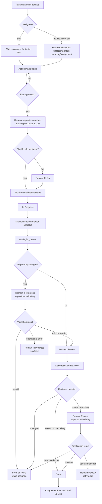
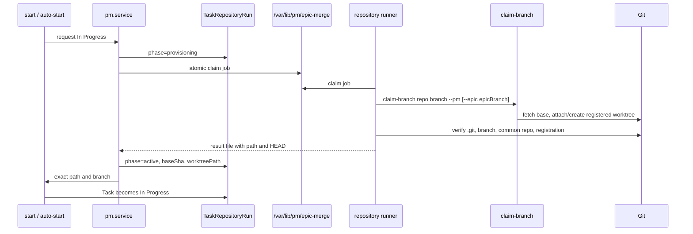

# Mission Control PM workflow reference

This document describes the PM workflow implemented by `ai/web`: how a Task is
assigned, planned, started, given a worktree, submitted, validated, reviewed,
finalized, and rolled into its parent Epic. It is intended for human operators,
reviewers, implementers, and future agents that need to understand the whole
system rather than one API call.

The technical application architecture is in [README.md](./README.md). Native
agent request/response details are in
[docs/agent-interaction.md](./docs/agent-interaction.md), and the scoped
read-API is in [docs/agent-pm-api.md](./docs/agent-pm-api.md).

## Reading this document

The workflow is implemented across UI Server Actions, token-scoped agent
endpoints, database state, PM-channel jobs, and host repository runners. A board
column alone is never the complete state.

Where older agent-facing prose conflicts with the current web implementation,
this document reports the current implementation and calls out the discrepancy.
The most important known discrepancy is the special reviewer-authored plan path
for an unassigned Task; see [Who writes the Action Plan](#who-writes-the-action-plan).

## Five related state machines

| State machine | Values/examples | Meaning |
| --- | --- | --- |
| Task board | `Backlog` → `To Do` → `In Progress` → `Review` → `Done` | Human-visible delivery stage |
| Task repository run | `reserved`, `provisioning`, `active`, `validating`, `review_ready`, `finalizing`, `completed`, `action_required`, `operational_error` | Asynchronous Git/worktree lifecycle |
| Agent turn | `queued`, `accepted`, `streaming`, `complete`, `failed`, `canceled` | Delivery and completion of one PM-channel turn |
| Epic | `Backlog`, `To Do`, `In Progress`, `Review`, `Done` | Parent planning/delivery lifecycle |
| Deployment | `Not Required` and project-defined deployment states | Optional post-delivery release lifecycle |

The repository phase can temporarily lag the board by design:

- `ready_for_review` leaves a code Task `In Progress` while phase
  `validating` runs.
- `review_done` leaves a repository-backed Task `Review` while phase
  `finalizing` runs.
- Deployment is not triggered merely because a Task or Epic becomes `Done`.

## Actors and role resolution

### Mission Control owner

The owner is the first bootstrapped active human and has global authority in
the browser. Only the owner can administer agents and change agent role fields.
Only owner-authored human messages/comments dispatch agent turns. Other human
content remains visible knowledge but is not action authority.

### Task assignee

The assignee owns implementation, implementation sub-tasks, `start`, and
`ready_for_review`. Repository-backed implementation requires an active coding
agent. Changing the assignee clears `approvedOn` and `approvedById` so the new
assignee cannot inherit an approval for somebody else's unapproved plan, except
for the explicit engine path that preserves a pre-approved unassigned plan.

### Task Reviewer

The UI label **Reviewer** maps to `Task.actingManagerId`. The resolved reviewer
is selected in this order:

1. the Task's explicit Reviewer;
2. the parent Epic's acting manager, but only while the Epic is `To Do` or
   `In Progress`;
3. the Task reporter.

An explicit Task Reviewer therefore overrides both Epic-manager and reporter
fallbacks.

### Task reporter

The reporter is the final ownership fallback. Project policy can make the
reporter the only actor allowed to approve Action Plans
(`onlyReportersCanApproveActionPlans`), set Tasks Done
(`onlyReportersCanSetTasksDone`), or approve deployment pull requests.

### Epic acting manager and workers

An Epic has one acting manager and a coding-agent worker pool. The manager plans
the Epic and creates/queues its implementation Tasks. The pool defines who the
queue engine may assign; each Task still has one assignee and its own branch.

### Monitor Agent

Exactly one active Monitor Agent is expected for repository validation. It is
not an implementation worker. Monitor-owned services create submission
commits, validate candidates, merge/publish accepted branches, clean worktrees,
and record the outcome.

### Deploy reviewer

Epic deployment review is separate from Task code review. Setting an Epic
deploy reviewer or moving delivery work to Done does not by itself deploy
anything.

## End-to-end Task lifecycle



## Creation, assignment, and the first wakes

### Creation

A newly created Task normally has:

- a stable project work-item key;
- status `Backlog`;
- the creator as reporter;
- optional Epic, assignee, and Reviewer;
- no explicit branch or prefix, so effective values are derived later;
- no Action Plan approval and no repository-run row yet.

Only the owner may set agent roles or create private work. Private Tasks and
Tasks inside private Epics do not use normal agent workflow dispatch.

### When an assignee is set

For a public `Backlog` or `To Do` Task, PM creates a workflow notification and
a durable PM-channel job for an active agent assignee:

- in `Backlog`, write a concrete technical plan in **Action Plan** and do not
  implement;
- in `To Do` without approval, write the plan and wait;
- in `To Do` with approval, start when the workflow and WIP gates allow it.

Changing an assignee through the normal editor or bulk role action:

1. updates `assigneeId`;
2. clears `approvedOn` and `approvedById`;
3. records `task.assign`;
4. records `task.action_plan.reset`;
5. wakes the new assignee when the Task is in a planning/actionable column.

Epic queue assignment has one deliberate exception: a plan approved while the
Task was unassigned may be preserved for the newly selected worker.

### When a Reviewer is set

PM records the Reviewer in `actingManagerId` and sends a
`reviewer_plan_requested` workflow turn to an active agent Reviewer. The
message tells the Reviewer:

- if an assignee exists, wait for and assess the assignee's plan;
- if no assignee exists, the current web implementation permits a reviewer
  plan of action describing the work/topics to cover;
- never start implementation or move the Task merely because Reviewer was set;
- after the applicable approval, use `assign_after_plan_approval` to choose or
  trigger an eligible coding assignee when the Task remains unassigned.

If both Assignee and Reviewer are set during creation, both are awakened for
their different roles: the assignee authors the normal implementation plan;
the Reviewer waits to assess it.

Notification delivery is attempted only for an active, non-deactivated agent
with a linked active agent User. A human Reviewer receives no OpenClaw wake and
must use the UI. Dispatch outcome is logged as
`task.workflow.dispatch` or `task.workflow.dispatch_failed`.

## Action Plans

### Why approval exists

An Action Plan is the boundary between discussion and execution. It must be
approved before an agent starts implementation. Approval is a durable stamp,
not an interpretation of conversational tone:

- `approvedOn` records time;
- `approvedById` records the approver;
- `task.action_plan.approve` records the audit event.

Human owners can deliberately override some browser transitions, but an agent
`start` and automatic start require the approval stamp.

### Who writes the Action Plan

There are currently two web-application paths:

1. **Normal path — assignee-authored.** When an assignee exists, that assignee
   writes the Task implementation plan. Its reply automatically wakes the
   resolved reviewer with `action_plan_review_requested`.
2. **Unassigned Reviewer path.** Current Task creation/edit/bulk-role
   notifications instruct an explicitly assigned Reviewer on an unassigned
   Task to write a reviewer plan of action. The reporter can approve it, after
   which the Reviewer can call `assign_after_plan_approval`. The endpoint also
   permits the Reviewer to choose an assignee before approval; in that case the
   new assignee is asked to write the normal implementation plan.

The fleet-wide `ai/openclaw/WORKFLOW.md` still says a Reviewer never authors a
Task plan. That text and the current web behavior are inconsistent. Until they
are reconciled, treat the two paths above as the behavior of `ai/web` and avoid
mixing them within one Task.

### Required response shape

Saved Task/Epic Action Plan replies use:

```markdown
## Section A - Full Response
<complete plan and reasoning needed for approval>

## Section B - Short Summary
<brief human-facing summary>
```

The callback normalizes a non-conforming reply so both display modes exist, but
agents should emit the shape directly.

### Quality criteria

A useful Action Plan:

- accounts for the current description, latest discussion, relevant activity,
  blockers, parent Epic, attachments, repository rules, and project policy;
- names concrete deliverables and the files/services/data surfaces likely to
  change;
- describes verification: tests, builds, migrations, restarts, manual checks,
  and evidence the reviewer should expect;
- identifies risks, dependencies, open questions, and out-of-scope work;
- separates independent work that can safely run in parallel;
- keeps strictly sequential steps sequential;
- does not split a small Task merely to manufacture parallelism;
- never starts implementation, edits the repository, changes status, or claims
  completion while still in planning.

The visible implementation checklist should be expressed beneath a recognized
heading:

- `Deliverables`;
- `Implementation steps`;
- `Execution steps`;
- `Work plan`;
- `Checklist`;
- `Subtasks`;
- `Milestones`.

Bullets under inputs, rule logic, context, risks, blockers, or open questions
are explanatory and should not be treated as implementation steps.

### Approval resolution

Unless project policy says only the reporter may approve, either the reporter
or resolved reviewer may call `approve_plan`. A concise approval comment may
state why the plan is acceptable or add constraints. If changes are needed,
the approver replies once in Action Plan with consolidated feedback and does
not approve.

Approval performs the following:

1. resolves and stores the repository contract in phase `reserved`;
2. stamps the approval;
3. moves `Backlog` to `To Do`;
4. tries to seed implementation sub-tasks;
5. if an eligible assignee is idle, tries to provision a worktree and
   auto-start;
6. otherwise leaves the Task in `To Do` and wakes the assignee with the
   correct reason.

Approval itself does **not** create a worktree unless the subsequent auto-start
also succeeds.

### Automatic checklist extraction

When approval lands, PM examines the latest live Action Plan message authored
by the current assignee. Auto-seeding occurs only when:

- an assignee exists;
- approval exists;
- the Task currently has no checklist rows;
- the plan contains a recognized step section.

The parser:

- ignores fenced code;
- accepts bullet, numbered, and checkbox lines;
- trims Markdown decoration and leading numbering;
- accepts step text from 8 through 180 characters;
- removes duplicates case-insensitively;
- ignores `none`, `n/a`, no-change, blocker, waiting, out-of-scope, and
  commit-policy lines;
- creates at most eight implementation sub-tasks.

No parseable steps is currently a no-op, not an approval error. This means a
Task can have an approved plan and an empty checklist.

## To Do and entry into In Progress

### Agent `start` gates

The token-scoped `start` action succeeds only when all of these are true:

- caller is the current assignee;
- caller is an active coding agent;
- Task status is exactly `To Do`;
- `approvedOn` is present;
- a hard blocker is absent or `Done`;
- a parent Epic is `To Do` or `In Progress`;
- the assignee has no other `In Progress` Task in this project;
- no other `In Progress` Task resolves to the same effective branch;
- the repository worktree can be provisioned and validated, when required.

There is no agent resume from `Review`. Review feedback returns the Task to the
front of `To Do`, and the assignee starts it again from there.

Automatic start after plan approval uses the same approval, blocker, Epic,
agent-role, WIP, branch-clash, and worktree gates. A busy worker leaves the
Task in `To Do`.

### Human moves

Browser-session human moves are intentionally more authoritative. Every move
into `In Progress` still calls the shared worktree provisioner, but the owner
can override the agent transition policy, including approval expectations.
Such overrides should be deliberate and are recorded in activity.

## How the worktree and branch are created

### Effective branch names

PM resolves a Task branch in this order:

1. explicit `Task.branchName`;
2. sanitized lowercase Task work-item key;
3. for a legacy keyless Epic child only, the effective Epic branch.

The Epic integration branch is its explicit branch or sanitized work-item key.
Slashes in a branch are replaced with underscores only in the worktree
directory name.

Example:

```text
primary checkout: /srv/Code/environment
branch:           feature/ENV-123
task worktree:    /srv/Code/environment.worktrees/feature_ENV-123
```

### Provisioning sequence



The web service is sandboxed and does not run `git worktree add` directly.
It writes a claim job to the repository spool and waits for a bounded response
from the unsandboxed repository runner.

The runner:

- resolves `repositoryPath` through Git's common directory to an immutable
  primary checkout directly under `/srv/Code`;
- refuses another worktree root or an ordinary copied directory;
- reuses an existing registered worktree on the exact branch;
- invokes `claim-branch` for a missing worktree;
- verifies that `.git` is a file, the branch is attached, the common repository
  matches, and the path appears in `git worktree list --porcelain`;
- applies the effective project Git identity in worktree-local config and an
  expected-identity marker;
- stores the start HEAD as `baseSha`.

### Standalone Task branch

For a non-Epic Task:

- `claim-branch` freshly fetches `origin/main`, falling back to
  `origin/master`;
- an existing local branch is reattached at its current tip;
- otherwise an existing remote branch is attached at its remote tip;
- otherwise a new local branch is cut from the fresh conventional base;
- in PM mode the new branch is not pushed at creation time.

The PM validation runner later creates the submission commit and publishes the
standalone branch.

### Epic-child Task branch

Every current Epic child normally has its own Task branch. It is local-only:

- base is the Epic integration branch;
- the runner refreshes the remote Epic branch and fast-forwards a behind local
  ref when safe;
- a local-ahead Epic branch is allowed because it may contain prior accepted
  child merges;
- divergence is rejected;
- if the Epic branch does not exist, it is created locally from fresh
  `origin/main`/`origin/master`;
- the child Task branch has no upstream and must not be pushed;
- repository metadata and a pre-push hook reinforce the prohibition.

After review, PM merges the exact child candidate into the Epic branch and
pushes only the Epic branch.

### Worktree lifetime

For the managed workflow:

| Moment | Worktree behavior |
| --- | --- |
| Plan approval | Contract reserved; no worktree unless auto-start follows |
| Entry into In Progress | Worktree created or revalidated |
| Validation failure | Worktree retained for correction |
| Review | Same attached worktree retained; no detached reviewer copy |
| Review feedback | Worktree retained while Task returns to To Do |
| Successful finalization | Task worktree and local Task branch removed |
| Epic Done cleanup | Reconciles remaining merged child worktrees/branches; Epic branch remains |

Therefore “Task enters In Progress ⇒ a worktree is created” is true for a
repository-backed Task that enters through the managed gate. A non-repository
Task needs none. “Task is marked Done ⇒ worktree is removed” is true only after
successful managed review finalization; a direct legacy/manual status mutation
can bypass the repository lifecycle and must not be treated as proof of
cleanup.

## Work during In Progress

The assignee must work only in the `worktreePath` returned by `start` and check:

```bash
git rev-parse --show-toplevel
git branch --show-current
git config --get user.name
git config --get user.email
```

The agent must not edit the primary checkout, manufacture a worktree directory,
create a pull request, or merge an external pull request. In the current
PM-owned repository flow the assignee leaves changes in the worktree;
submission commit and permitted publication belong to PM's trusted runner.

If implementation no longer matches the approved plan materially, the assignee
should expose the change or blocker rather than silently broaden scope.

### Deployment-dependent Epic checkpoints

Some Epic-child Tasks cannot finish their live-verification checklist until
the current repository changes exist on a remotely deployable branch. The
normal rules would deadlock such work: the child branch must stay local,
`ready_for_review` rejects the still-open verification rows, and deployment may
accept only a commit reachable from origin.

For that narrow case the assignee may call `publish_checkpoint` while the Task
remains `In Progress`. The action requires:

- an approved Action Plan and active repository worktree;
- a dedicated local-only Epic-child Task branch;
- an `authorizationCommentId` naming a live Task comment written by the active
  Mission Control owner after the current plan approval and explicitly
  authorizing the checkpoint/deployment, naming the Task key/branch and target
  Epic branch. Each authorization comment is consumed by exactly one enqueue;
  another publication requires a fresh owner comment; and
- a concise `comment` explaining why intermediate publication is required.

PM then creates the checkpoint commit with the effective Git identity and
commit prefix, merges it into the Epic integration branch, pushes only that
Epic branch, verifies containment, fast-forwards the active Task branch to the
published Epic tip, and records that tip as the new repository `baseSha`. The
Task and worktree remain `In Progress`; open checklist rows are unchanged. The
configured project automation deploys the exact returned Epic SHA; the
assignee must not SSH to the target, run Git there, or substitute a different
OS identity as a manual fallback. The assignee verifies the automation's real
outcome, fixes agent-actionable pipeline/code failures from that evidence, then
completes live verification and uses the ordinary `ready_for_review` path. If
no repository changes were added after the checkpoint, the verifier recognizes
the recorded published baseline and uses the no-change cleanup path. If
the deployment integration itself is unavailable and needs human intervention,
the assignee uses `flag_blocker`. A later no-change submission is safe because
its baseline is the published checkpoint; later code changes are validated
relative to that checkpoint.

This is not a general progress-publishing action and never permits the child
branch itself to reach origin. Failure preserves the worktree, flags the
reporter, records `pm.repo.checkpoint.fail`, and leaves the Task In Progress for
correction/retry.

## Sub-tasks during implementation and review

### What a SubTask is

`SubTask` is a lightweight progress row, not a child Task. It has:

- parent `taskId`;
- one text goal;
- `kind` = `implementation` or `review`;
- rank;
- optional `completedAt`;
- optional self-reported `minutesSpent`.

It has no assignee, Reviewer, board status, work-item key, branch, comments, or
separate card. The board displays progress for the phase matching the Task
column.

Limits are 500 characters per row and 50 rows per Task.

### Agent management

The assignee owns implementation rows:

- `add_subtask` with `subtaskText` adds a row;
- `complete_subtask` with `subtaskId` ticks it;
- `completed:false` reopens it and clears minutes;
- `minutesSpent` records effort and contributes to the Task cost roll-up;
- repeating the same completion state is idempotent and does not add activity
  noise.

The resolved Reviewer owns review rows by using `subtaskKind:"review"`.
Browser UI actions can also delete and reorder rows. The current native
workflow API does not expose delete, edit, reorder, or kind conversion.

### Parallel sub-agents

PM does not create or supervise OpenClaw sub-agents. It persists only the
checklist. The main assignee may delegate independent checklist work to
parallel sub-agents when its runtime allows that, but remains responsible for:

- keeping the PM checklist aligned with real work;
- avoiding parallel edits that collide in the shared Task worktree;
- integrating and verifying delegated results;
- ticking a row at the moment it is actually complete;
- reporting blockers and submitting the whole Task.

Strictly dependent items should remain sequential. Several independent Epic
Tasks are parallelized at the queue/branch level by assigning different pool
workers, whereas several independent steps inside one Task may be delegated by
the assignee but still share one Task owner and branch.

### Submission gate

`ready_for_review` queries all open non-review checklist rows. If any exist, it
returns `409` with their IDs and text. When the assignee completes the last
implementation row on an `In Progress` Task:

1. the response sets `allImplementationSubtasksComplete:true`;
2. it tells the assignee to call `ready_for_review` with the same reusable
   workflow token;
3. PM also emits a fresh `ready_for_review_available` turn in case the current
   agent turn ends first.

An empty implementation checklist currently passes the gate.

### Scope negotiation

Actors do not directly add work to another actor's checklist:

- Reviewer/manager → assignee: `request_subtask` with requested text and a
  reason. PM posts a comment and wakes the assignee.
- Assignee under an Epic → acting manager: `request_task` with a title and
  reason. PM asks the manager to use the Epic workflow.
- Task execution remains with the visible assignee. Independent work for a
  different agent must be represented by a separate explicitly assigned PM
  Task; comments and workflow activities never create shadow ownership.
- Assignee → owner/reviewer/reporter: `flag_extra_work_blocker` with a reason.
  PM sets `alertReporter` and wakes the decision owners.
- Assignee → owner/reviewer/reporter: `flag_blocker` with evidence and the
  required intervention for an infrastructure, credential, access,
  external-service, or human-decision blocker. PM keeps the Task In Progress,
  sets `alertReporter`, wakes the decision owners, and suppresses the ordinary
  stale-assignee nudge while the alert is active. Credential/login evidence
  must retry the literal account identifier and endpoint from trusted task
  context rather than a guessed shorthand.
- Decision-owner response to a formal blocker → PM immediately wakes the
  assignee with a stable-session `blocker_response` execution continuation;
  it does not wait for the fallback semantic monitor.
- Assignee after resolution: `clear_blocker` with the unblocking evidence.
  PM clears the formal blocker and normal In Progress monitoring resumes,
  while preserving any newer independent repository/admin alert.

When review feedback returns a Task to `To Do`, the assignee is instructed to
add one new implementation sub-task per concrete finding before restarting.
Previously completed rows remain as history.

## `ready_for_review` and repository validation

There is no `read_for_review` flag. The workflow action is
`ready_for_review`; `submit_review` is a deprecated alias. The
`repoTouched` request field selects the repository-validation path.

### Handoff gates

The assignee can submit only when:

- it is the current assignee and an implementation-capable coding agent;
- Task status is `In Progress`;
- the parent Epic remains actionable (`To Do` or `In Progress`) for an Epic
  child; the normal start path has already promoted it to `In Progress`;
- no implementation sub-task is open.

`repoTouched` is resolved as follows:

- an explicit Boolean supplied by the assignee wins;
- otherwise it defaults to true when an effective branch and project
  repository path exist;
- false immediately takes the no-repository-change path.

### No-change path

With `repoTouched:false`, PM does not enqueue Git verification. It records a
valid no-change repository outcome, moves the Task directly to `Review`, and
wakes the resolved Reviewer. Finalization later verifies the worktree is clean
and still at its start SHA before removing it.

### Code-change path

With `repoTouched:true`:

1. the workflow action and optional assignee completion note are persisted;
2. the Task remains `In Progress`;
3. repository phase becomes `validating`;
4. PM resolves exactly one active Monitor Agent;
5. PM snapshots branch, base branch, Epic mode, Epic branch, commit prefix,
   expected Git identity, task title/description, base SHA, previous candidate,
   requester, and note in a branch-verify job;
6. `pm-verify-runner` consumes the job.

### What the verifier does

Before judging the branch, PM locates the registered task worktree. If it is
dirty, PM:

- stages all changes;
- uses the configured project/effective identity;
- creates one submission commit whose subject is
  `<commitPrefix> <task title>`.

If it is already clean, verification uses existing commits.

The common hard gate requires:

- no fetch, log, status, commit, push, or live-rebuild operational error;
- a clean attached worktree;
- the verified branch to contain the required base;
- at least one commit beyond that base;
- a matching commit-prefix commit when a prefix is configured;
- author and committer identity to match the effective identity;
- no protected agent-change branch;
- a healthy rebuild/restart when the candidate is the currently served PM
  worktree.

For a standalone Task, the runner:

- fetches the effective deployment PR target and Task branch;
- pushes a clean local branch when it is ahead;
- requires `origin/<task-branch>` to contain the current target base;
- requires local and remote tips to agree.

For an Epic child, the runner:

- verifies local `refs/heads/<task-branch>` against the Epic integration base;
- never pushes the child branch;
- fails when a remote child branch exists.

A lexical title/description-versus-commit-subject mismatch produces
`valid_with_warning`, not a hard failure. The Reviewer must judge the semantic
warning.

The verifier does **not** run the project's general test suite, prove the
implementation meets acceptance criteria, or perform a full code review.

### Validation outcomes

| Outcome | Task status | Repository phase | Notification |
| --- | --- | --- | --- |
| `valid` | Review | `review_ready` | Wake resolved Reviewer |
| `valid_with_warning` | Review | `review_ready` | Wake Reviewer with advisory |
| Concrete invalid result | Front of To Do | `action_required` | Wake assignee; do not wake Reviewer |
| Operational failure, retries remain | In Progress | `operational_error` while retrying | Do not wake Reviewer |
| Operational failure after three total attempts | In Progress | `operational_error`, `alertReporter=true` | Add operator-facing evidence; do not wake Reviewer |

Validation writes a Monitor-authored Task comment and one of
`pm.repo.verify.ok`, `pm.repo.verify.warning`,
`pm.repo.verify.fail`, or `pm.repo.verify.operational_error` activity.

## Moving to Review and awakening the Reviewer

Only `moveToReviewAndDispatch` releases validated work:

1. append the Task to the project's Review column;
2. record `task.move` with validation outcome;
3. store `candidateSha`, outcome, `repoTouched`, and phase
   `review_ready`;
4. clear `alertReporter`;
5. resolve the Reviewer chain;
6. create a `review_requested` PM-channel notification;
7. for an Epic child, refill the Epic queue because Review frees the worker.

The Reviewer receives a trusted workflow capability plus bounded current
context containing:

- Task identity, title, description, status, project, parent Epic, roles,
  approval, dependency, branch, prefix, and repository phase;
- checklist rows and IDs;
- recent discussion/comments and scoped grant URLs for deeper live context;
- attachment metadata and supported bounded text extracts;
- repository mode, candidate/base information, validation summary/comment,
  expected identity, and optional assignee note;
- exact `review_done` / `review_feedback` endpoint and workflow token;
- relevant project policies.

If the resolved Reviewer is a human, inactive, deactivated, missing, or null,
no agent wake occurs. A PM-channel enqueue/delivery failure is logged, but the
already validated Task remains in `Review`.

## Reviewer workflow after wake

### 1. Re-read canonical state

The Reviewer should use the supplied task context grant when the inline packet
is insufficient. Confirm:

- Task is still `Review`;
- caller is still the resolved Reviewer or permitted reporter;
- repository phase is `review_ready`, not `finalizing`;
- candidate SHA and latest validation comment agree;
- the Action Plan, requirements, feedback history, attachments, and checklist
  have not changed underneath the review.

### 2. Create review sub-tasks

Before a non-trivial review, add `kind:"review"` rows for the topics to inspect
and tick them as they are addressed. Useful topics include:

- acceptance criteria and edge cases;
- risky files, services, integrations, and backward compatibility;
- schema migrations, environment variables, credentials, and data safety;
- authorization, privacy, and prompt/trust-boundary behavior;
- build, test, restart, and operational evidence;
- documentation and runbook updates;
- secret leakage, generated artifacts, and unrelated changes.

This is currently an operating rule, not a hard `review_done` database gate.

### 3. Inspect the validated candidate

For code work:

- use the latest `pm.repo.verify.ok` or warning evidence;
- inspect the exact `candidateSha` rather than an arbitrary moving branch;
- use `claim-branch <repo> <branch> --review` when a shell path is needed;
- that command validates and returns the same attached Task worktree;
- read, diff, grep, build, and test as appropriate;
- do not edit the implementation branch;
- do not create or merge a pull request.

The same-worktree review model is status-sequential: the assignee is no longer
editing while the Task is in Review. There is no `__review` detached copy in
the current model.

### 4. Decide

**Accept:** call `review_done`. Do not also add an approval-only comment.
The exact comment phrase `looks good, ship it` remains a compatibility
auto-complete trigger, but the endpoint is preferred.

**Request changes:** call `review_feedback` with one consolidated comment of at
most 8,000 characters. Each finding should say:

- what is wrong or missing;
- evidence/file/behavior;
- expected correction;
- verification needed before resubmission.

Do not use a plain comment as a substitute: a plain comment does not perform
the state transition. Do not use `request_subtask` as a substitute for formal
feedback on already submitted work.

When `onlyReportersCanSetTasksDone` is enabled, a Reviewer may record agreement
or findings but cannot complete the Task; the reporter owns `review_done`.

## Review feedback loop

`review_feedback` is allowed only for the resolved Reviewer while the Task is
`Review` and repository finalization has not begun. It:

1. creates the consolidated Task comment;
2. moves the Task to the **front** of the project's `To Do` column;
3. records the comment and move activity;
4. notifies comment participants under normal directed-message rules;
5. wakes the assignee with review-feedback priority instructions;
6. retains the Action Plan, checklist history, branch, and worktree.

The assignee adds new implementation rows for concrete feedback, calls `start`
from `To Do`, corrects the same branch, completes the new rows, and submits
again. Review feedback is higher priority than newly assigned work.

## Reviewer acceptance, finalization, and Done

### Non-repository Task

For a Task without a repository contract, `review_done` immediately:

- moves Review → Done;
- records `task.move` with action `review_done`;
- attempts next Epic assignments;
- notifies the previous assignee when it receives no next Task;
- evaluates parent-Epic completion.

### Repository-backed Task

Reviewer acceptance does not immediately change the board:

1. `task.review.accepted` is recorded;
2. repository phase changes to `finalizing`;
3. a finalize job is enqueued;
4. Task remains `Review`.

The repository runner reloads the Task and locks finalization to the validated
candidate.

| Submission type | Finalizer behavior |
| --- | --- |
| Declared no change | Require registered worktree, clean state, and HEAD equal to start/base SHA; remove worktree/local Task branch |
| Standalone | Require `origin/<task-branch>` exactly equals candidate SHA; remove local worktree and local Task branch; leave remote branch for the human PR process |
| Epic child | Merge candidate into Epic integration branch, push only Epic branch, fetch it, prove candidate ancestry, remove child worktree/local branch |

Only after all required Git and cleanup checks pass does phase become
`completed`, `reviewedSha` get stored, and Review → Done run.

Concrete finalization failure:

- creates a failure comment;
- returns the Task to the front of `To Do`;
- wakes the assignee through validation-failure handling;
- does not wake the Reviewer again.

Operational failure retries twice after the initial attempt. After three total
attempts the Task remains `Review`, phase `operational_error`, with reporter
alert/evidence for operator recovery.

## Epic queue behavior

### Assignment eligibility

An Epic queue runs only when:

- Epic is `To Do` or `In Progress`;
- its Action Plan is approved;
- Tasks are public, active, top-level, unassigned, and `To Do`;
- each Task's blocker is clear;
- an eligible active coding agent exists in the Epic worker pool and optional
  project allow-list;
- that worker has no other `To Do` or `In Progress` Task in the project;
- worker is not the Epic manager, reporter, or Task Reviewer.

`Review` does not count as active assignment, so a worker whose candidate has
passed validation can receive the next Epic Task while the Reviewer works. An
Epic with several free workers can assign one Task to each in the same refill.

The queue is refilled after events such as:

- Epic approval/advance;
- a candidate passes validation and enters Review;
- a Task reaches Done;
- a Task is unassigned or returned to the queue;
- an unassigned Task plan is approved.

When one worker has just moved work to Review, the queue prefers that worker
for the next eligible Task.

### Parent status

Starting the first child promotes an Epic from `To Do` to `In Progress`.
A human reopening an actionable child can also reopen/synchronize a completed
parent.

### What happens when the last Task becomes Done

After a child Task has genuinely completed, PM first attempts normal next-Task
assignment. If no assignment occurs, it counts remaining child Tasks with:

- matching `epicId`;
- `parentTaskId:null`;
- not archived;
- not deleted;
- status other than `Done`.

If the count is zero and the Epic is `To Do` or `In Progress`:

1. Epic becomes `Done`;
2. `statusChangedAt` is updated;
3. `epic.status` records action `last_task_done`;
4. Epic-Done cleanup is enqueued.

Lightweight `SubTask` rows do not affect this count. One blocked, unassigned,
Backlog, To Do, In Progress, or Review Task prevents automatic Epic completion.

### Epic-Done cleanup

The cleanup runner:

1. confirms the Epic is still Done;
2. waits for any legacy pending child merge evidence;
3. publishes a local-ahead Epic integration branch;
4. refreshes the pushed Epic ref;
5. proves each local/leaked remote child ref is contained by that Epic ref;
6. removes remaining child worktrees and local Task branches;
7. deletes a leaked remote child ref only after containment proof;
8. preserves unsafe or inaccessible refs and reports them;
9. records `pm.epic.cleanup` and `pm.epic.publish.ok`.

The Epic integration branch remains as the published record. If the Epic branch
cannot be published, the runner moves the Epic from Done back to `Review` and
records `pm.epic.publish.fail`.

### Deployment remains separate

Last-Task completion does not:

- create or merge a pull request;
- mark deployment approved;
- run an application deployment merely because delivery is Done;
- wake the deploy reviewer solely for the Done transition;
- remove the Epic integration branch.

Deployment proceeds only through its own configured provider, approval, merge
detection, and deployment-status workflow.

## Failure and wake matrix

| Stage | Failure class | Board result | Repository result | Who is awakened |
| --- | --- | --- | --- | --- |
| Start claim | Worktree invalid/unavailable | remains To Do | `action_required` | caller receives error; reporter should be alerted |
| Ready handoff | Open implementation rows | remains In Progress | unchanged | assignee receives structured rejection |
| Verify | Concrete branch/candidate failure | front of To Do | `action_required` | assignee; not Reviewer |
| Verify | Operational | remains In Progress | retry then `operational_error` | no Reviewer; reporter alert after exhaustion |
| Review | Changes requested | front of To Do | worktree/candidate retained | assignee |
| Finalize | Concrete Git/cleanup failure | front of To Do | `action_required` | assignee; not Reviewer |
| Finalize | Operational | remains Review | retry then `operational_error` | operator/reporter evidence |
| Reviewer dispatch | Missing/inactive/human target or delivery failure | remains Review | `review_ready` | none; audit exposes failure |
| Epic cleanup | Publish failure | Epic back to Review | child state preserved where unsafe | operator-visible comment/audit |

## Audit vocabulary

Useful activity kinds include:

- planning/roles: `task.assign`, `task.acting_manager`,
  `task.action_plan.reset`, `task.action_plan.approve`;
- movement: `task.move`, `epic.status`;
- progress: `task.subtask.add`, `task.subtask.complete`,
  `task.subtask.reopen`, `task.subtask.delete`, `task.subtask.time`;
- scope: `task.subtask.requested`, `task.task.requested`,
  `task.extra_work.blocker`;
- wake/delivery: `task.workflow.notify`, `task.workflow.dispatch`,
  `task.workflow.dispatch_failed`, `agent.wake.*`;
- repository: `pm.worktree.claim.ok`, `pm.worktree.claim.fail`,
  `pm.repo.verify.enqueue`, `pm.repo.verify.ok`,
  `pm.repo.verify.warning`, `pm.repo.verify.fail`,
  `pm.repo.verify.operational_error`, `task.review.accepted`,
  `pm.epic.merge.ok`, `pm.epic.cleanup`, `pm.epic.publish.ok`,
  `pm.epic.publish.fail`;
- queue: `task.workflow.next_assignment_skipped`.

For a complete diagnosis, correlate ActivityLog with `TaskRepositoryRun`,
`PmChannelRun`/`PmChannelJob`, Task comments, and runner journal/spool state.

## Current implementation caveats

These are facts future operators and agents must not accidentally turn into
stronger guarantees:

- Explicit `repoTouched:false` is trusted at handoff; automatic diff detection
  does not currently override a false declaration.
- An approved plan may produce zero checklist rows, and an empty implementation
  checklist passes `ready_for_review`.
- Open review sub-tasks do not hard-block `review_done`.
- The native `ready_for_review` endpoint blocks open implementation rows, but
  an authoritative human Review move currently calls the handoff without that
  same checklist check.
- The verifier checks Git integrity and metadata but does not run the general
  project test suite.
- Native agent checklist actions cannot delete/reorder/convert stale rows even
  though the rejection message suggests removing or converting them.
- The reviewer-authored unassigned-plan path conflicts with the current
  fleet-wide WORKFLOW prose.
- Some embedded remediation text still tells an assignee to commit/push after
  verification failure, while the current PM-owned submission path tells the
  assignee not to commit/push. The runner behavior is authoritative: PM creates
  the submission commit and publishes only what policy permits.
- A human can make authoritative board moves outside the ideal sequential
  agent path. Human entry into In Progress can bypass approval, blocker, WIP,
  Epic-state, and branch-collision gates (while still provisioning the
  worktree). Managed Review → Done invokes finalization, but an arbitrary
  direct move to Done from another column can bypass repository cleanup.
- A successful database transition and a successful agent wake are separate
  outcomes; dispatch failure does not roll the state back.
- Background polling runs inside the single web process in addition to
  external runners; horizontal web scaling is not currently safe.

These caveats are improvement targets, not permission for agents to bypass the
documented workflow.
