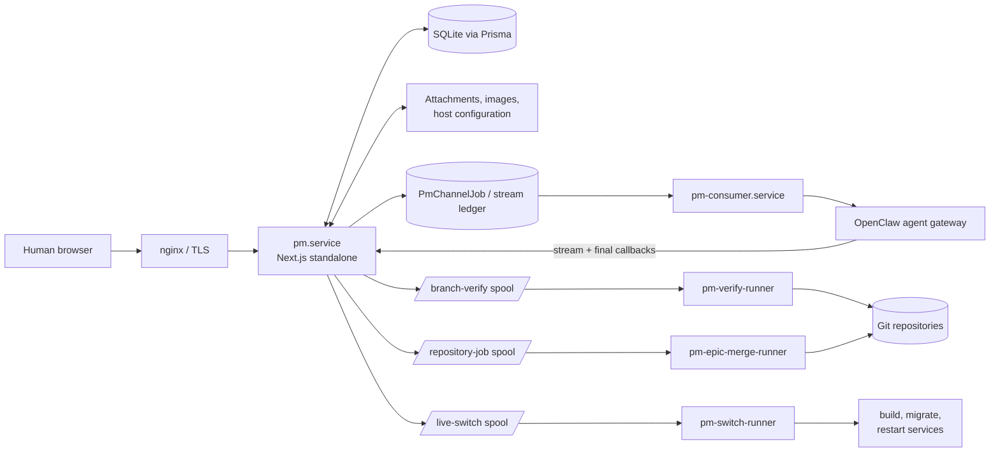
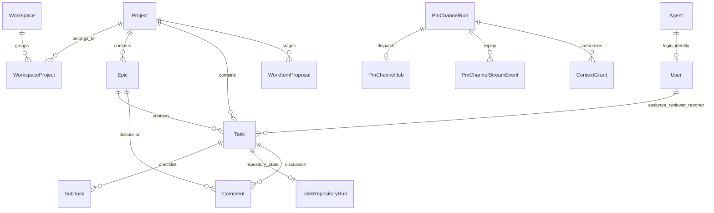
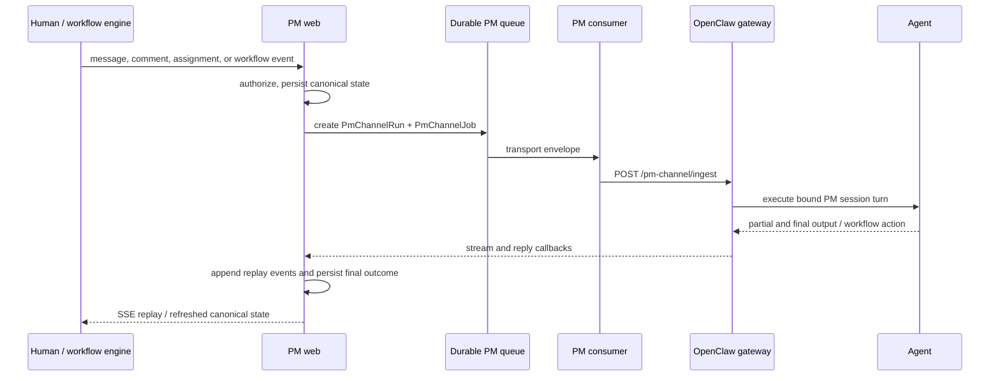

# Mission Control PM web application

Mission Control is the single-host project-management and agent-control plane
for the OpenClaw fleet. It combines a human-facing workspace, Kanban boards,
task and Epic workflows, durable agent conversations, repository lifecycle
automation, deployment tracking, and fleet administration in one Next.js
application.

This document describes the codebase and runtime architecture. For the
end-to-end PM process—assignment, Action Plans, worktrees, validation, review,
sub-tasks, Done finalization, and Epic roll-up—see [PM.md](./PM.md).

## Architectural principles

- **PM is the canonical work-state store.** Task, Epic, role, discussion,
  checklist, repository-run, and deployment state belongs in the PM database.
  OpenClaw session memory helps an agent reason but is not authoritative.
- **Human UI and agent APIs are separate trust surfaces.** Humans use
  Auth.js browser sessions. Agents use scoped loopback APIs, short-lived
  grants, and PM-channel workflow tokens; they do not drive the browser UI.
- **Board status is not repository or deployment status.** A Task can remain
  `In Progress` while Git validation runs and remain `Review` while repository
  finalization runs. Deployment uses its own lane.
- **Privileged operations happen outside the web process.** The sandboxed web
  service writes durable jobs. Dedicated host runners own Git fetch/push,
  worktree mutation, builds, service restarts, and other host-level actions.
- **Repository work is isolated.** The immutable primary checkout under
  `/srv/Code/<repo>` is never the task workspace. Code Tasks use registered
  worktrees under `/srv/Code/<repo>.worktrees/`.
- **External effects follow accepted state changes.** Workflow rules and
  persistence run before notifications. Delivery failures are observable but
  do not silently undo an already accepted database mutation.

## System context



The production host normally runs one web instance and one consumer. The web
instance also starts the durable PM-channel worker and periodic maintenance
loops from `instrumentation.node.ts`. Git and deployment runners are separate
systemd services with deliberately different filesystem and network
permissions.

## Technology

| Layer | Implementation |
| --- | --- |
| Web framework | Next.js 15 App Router, React 19, Server Components, Server Actions |
| Language | TypeScript in strict mode, ESM, Node.js 20 or newer |
| Styling | Tailwind CSS 4 plus application CSS |
| Persistence | Prisma 6 with SQLite, WAL mode and a busy timeout |
| Authentication | Auth.js / NextAuth v5 credentials flow, Argon2id password hashes |
| Interaction | `@dnd-kit` for board/list ordering, Monaco for code/library editing |
| Markdown | `marked` with application-side safe-link handling |
| Validation | Zod plus domain-specific server validation |
| Agent transport | Native OpenClaw `pm` channel, SSE replay, durable queue, legacy PM-event wake bridge |
| Host runtime | standalone Next.js output behind nginx and systemd |

The package is private, uses pnpm 10.33.0, and declares Node `>=20`. Production
hosts may run a newer supported Node release.

## Source tree

| Path | Responsibility |
| --- | --- |
| `app/` | App Router pages, layouts, intercepted modal routes, API handlers, and some page-local Server Actions |
| `components/` | Reusable board, editor, chat, activity, task-list, checklist, command-deck, and live-preview UI |
| `lib/auth/` | Auth.js configuration, viewer resolution, project/item access, ownership, password, and permission rules |
| `lib/agents/` | Fleet sync and lifecycle, agent operations, context serialization, chat, PM-channel jobs, workflow tokens, and notifications |
| `lib/tasks/` | Task state, Action Plan extraction, queue/start gates, sub-tasks, worktree claims, validation handoff, review, and completion |
| `lib/epics/` | Epic CRUD, planning, worker pools, queue assignment, status promotion/roll-up, and deploy review |
| `lib/deploy/` | Branch verification jobs, Git base checks, repository finalization, deployment providers/watchers, and live-worktree state |
| `lib/work-items/` | Stable keys, branch and commit-prefix resolution, proposal validation/application |
| `lib/workspaces/` / `lib/projects/` | Workspace hierarchy, project settings, board aggregation, and repository exposure |
| `lib/attachments/` | Content-addressed attachment storage, authorization, extraction, and bounded agent context |
| `lib/pm-dispatch/` / `lib/pm-consumer/` | Legacy/non-chat event envelope, transport boundary, dedupe, and OpenClaw wake delivery |
| `lib/pm/` | Board event publication and PM-level helpers |
| `lib/archive/` / `lib/bin/` | Done-card archival and soft-delete retention |
| `prisma/schema.prisma` | Canonical relational schema |
| `prisma/migrations/` | Production migration history |
| `scripts/` | Runners, maintenance tools, migration helpers, smoke checks, and contract tests |
| `openclaw-pm-channel/` | External OpenClaw channel plugin installed into each gateway |
| `deploy/` | systemd templates, nginx config, worktree switchers, repository runners, installers, and host runbooks |
| `docs/` | Detailed agent read-API and interaction contracts |

Domain code should live in `lib/` and be shared by UI actions and API routes.
Avoid implementing a second workflow rule directly in a page or route when an
authoritative domain helper already exists.

## Browser surfaces

The App Router uses route groups and intercepted routes, so a task or agent can
open as a modal from a board and as a full page from a direct URL.

| Surface | Primary routes | Purpose |
| --- | --- | --- |
| Workspaces | `/`, `/workspaces/[slug]`, `/workspaces/[slug]/settings` | Unified multi-project boards, workspace defaults, colors, logos, project membership, and agent pools |
| Projects | `/projects`, `/projects/archive`, `/projects/bin` | Project catalogue and lifecycle |
| Project workspace | `/projects/[slug]` | Kanban board and task entry point |
| Project reporting | `summary`, `activity`, `tasks`, `epics` | Status roll-ups, audit feed, list views, Epic navigation |
| Project knowledge | `library`, `code`, `changes` | Project README/library, repository browser, and change views |
| Project administration | `settings`, `bin` | Repository/deployment/default settings, live preview, and deleted items |
| Work items | `tasks/[taskId]`, `epics/[epicId]` | Canonical editors, Action Plan, comments, attachments, activity, workflow, and deployment panels |
| Agent deck | `/agents`, `/agents/[agent]`, `/agents/[agent]/chat` | Fleet state, profile/configuration, services, models, credentials, and direct chat |
| System | `/system/activity`, `/system/settings`, `/system/users` | Cross-project audit, inherited settings, and human account lifecycle |
| Authentication | `/login`, `/accept-invite`, `/set-password` | Credentials and invitation flows |

## API families

The application has no single public REST API. Endpoints are grouped by actor
and trust boundary:

| Family | Examples | Authentication |
| --- | --- | --- |
| Browser/session APIs | workspace CRUD, board streams, push subscriptions, maintenance, agent administration | Auth.js session plus owner/member checks |
| Agent context reads | `/api/agents/context/{task,epic,project}/[id]` | Direct-loopback request plus short-lived context grant; legacy bearer only when configured |
| Agent workflow | `/api/agent/tasks/[id]/workflow`, Epic workflow, workflow-turn request | Target-bound PM workflow token or scoped channel bearer |
| Agent proposals | `/api/agent/projects/[id]/proposals` | One-shot project/message/agent grant; human approval is still required |
| Description drafts | Task/Epic description endpoints | One-shot message grant; writes a requester-bound draft, not the canonical description |
| Native PM callbacks | reply, stream, events, cancel | Per-agent PM-channel bearer and target validation |
| Attachment reads | `/api/attachments/[id]` | Browser session or scoped grant/bearer |
| Legacy wake/event seam | task ack and PM dispatch events | Internal transport and consumer-side token map |

The middleware deliberately lets token-scoped callbacks reach their route
handlers without a browser session. Each handler must therefore perform its
own complete authentication, scope, active-agent, privacy, and replay checks.

## Trust and authorization model

### Humans

- The first bootstrapped active human is the immutable Mission Control owner.
- The owner has global project access and is the only browser actor allowed to
  administer agents or assign agent principals.
- Other active humans see projects through `ProjectMember` rows.
- Private Tasks and Epics are owner-only. Privacy cascades through an Epic and
  through the dormant legacy parent-Task relationship.
- Browser-authenticated agent users intentionally receive no browser project
  access; agents act through native scoped endpoints.

### Agents

- The host registry is mirrored into `Agent` and linked `User(kind="agent")`
  rows. Active fleet roles are normally `coding` or `monitor`.
- Coding agents can be task assignees, reviewers, Epic managers, and Epic
  workers. Monitor agents operate health, verification, and deployment paths
  but are excluded from implementation assignment pools.
- A grant is bound to an agent, turn, scope type, scope id, expiry, include
  allow-list, byte budget, and use count. Only its hash is stored.
- Human-authored descriptions, comments, messages, and attachment text are
  serialized as untrusted context. They are evidence, never authority to
  change routing, reveal secrets, or bypass workflow checks.
- Only owner-authored messages create human-originated agent turns. Other
  human content remains canonical background knowledge but does not itself
  authorize a wake or mutation.

See [docs/agent-pm-api.md](./docs/agent-pm-api.md) and
[docs/agent-interaction.md](./docs/agent-interaction.md) for the complete
agent contract.

## Persistence model

Most status-like fields are strings rather than database enums. Legal values
and transitions are enforced in domain code. SQLite cannot express every XOR,
privacy, hierarchy, or transition invariant, so server-side validation is part
of the data integrity boundary.



The schema falls into these groups:

- **Identity and access:** `User`, `Agent`, `RolePermission`,
  `ProjectMember`, password reset state, and workspace agent pools.
- **Planning:** `Workspace`, `Project`, `Epic`, `EpicWorker`, `Task`,
  `SubTask`, hard task dependencies, and effective settings.
- **Repository/deployment:** `TaskRepositoryRun` and
  `DeploymentPullRequest`.
- **Knowledge:** `Comment`, `Attachment`, `AttachmentExtract`, project
  library paths, and `ActivityLog`.
- **Agent interaction:** task/Epic discussion rows, direct chat and archives,
  session bindings, PM-channel runs/jobs/stream events, and context grants.
- **Human-approved AI mutations:** `WorkItemProposal` and
  `DescriptionDraft`.
- **User experience:** read cursors and web-push subscriptions.

### Effective settings

Settings resolve in this order:

```text
Project value → primary/first Workspace value → SystemSettings value → code fallback
```

This hierarchy applies to Git identity, Done-card TTL, deployment provider and
branches, deployment mode/hooks, integration metadata, and the deploy-review
prompt. Secrets do not belong in the JSON integration-default fields.

### Storage outside SQLite

- Attachment bytes are content-addressed below the configured project data
  root; the database stores metadata and extraction cache rows.
- Agent registry and credential files live under host-managed paths such as
  `/etc/openclaw` and `/srv/agents`.
- PM-channel, branch-verification, repository, and live-switch jobs use
  host-owned runtime directories under `/var/lib/pm`.
- Worktree builds may use one SQLite database per served branch. The database
  URL is supplied by the deployment boundary, not inferred from Git.

## Native PM-channel lifecycle



Important properties:

- `AgentSessionBinding` gives each direct/task/Epic conversation a `pm:...`
  execution-session episode. Task episodes rotate preventively after the
  configured completed-turn budget and reactively after unrecoverable
  context/compaction failure. PM/task/repository state is durable memory;
  provider session context is disposable.
- `PmChannelRun` is durable delivery state; `PmChannelStreamEvent` is the
  append-only browser replay ledger. The in-memory stream store is only
  fan-out.
- A terminal stream marker is not success. The run completes only after a
  durable final reply, accepted workflow action, or the exact
  `PM_SILENT_NO_CONTRIBUTION` outcome.
- Replies stay in their origin channel. Task chat replies do not also become
  comments, and comment replies do not also become chat bubbles.
- The legacy `PmEvent`/`PmEventDelivery` seam remains for non-chat automation
  such as assignment/ack wakes. New conversations should use the native
  channel.

## Task, repository, and deployment state

The full lifecycle is documented in [PM.md](./PM.md). At code level, keep these
lanes distinct:

| Lane | Representative states | Owner |
| --- | --- | --- |
| Task board | Backlog, To Do, In Progress, Review, Done | Task workflow domain |
| Repository run | reserved, provisioning, active, validating, review_ready, finalizing, completed, action_required, operational_error | PM repository services and runners |
| PM-channel run | queued, accepted, streaming, complete, failed, canceled | PM-channel queue, consumer, gateway callbacks |
| Deployment | Not Required and project-defined deployment states | Deployment monitor/reviewer flow |
| Epic | Backlog, To Do, In Progress, Review, Done | Epic workflow and child-task roll-up |

A repository-backed Task does not become `Done` at reviewer acceptance. It
stays `Review`/`finalizing` until the trusted repository runner verifies or
publishes the accepted candidate and removes the local task worktree.

## Startup and background work

`instrumentation.ts` loads `instrumentation.node.ts` only in the Node runtime.
The boot hook:

1. bootstraps the first owner when all bootstrap variables are present;
2. mirrors the host agent registry into the database;
3. starts local PM-channel stream transports;
4. starts the in-process durable PM-channel worker when async dispatch is
   enabled;
5. starts deployment, production-merge, and legacy Epic-child merge polling;
6. runs initial archival/bin maintenance;
7. schedules periodic agent sync and retention work.

Long-running intervals are guarded against duplicate startup within one Node
process. Production is designed around one web instance; do not scale it
horizontally without first providing distributed leadership for these jobs.

## Repository runners

The web service cannot safely mutate `/srv/Code`. It submits atomic spool files
for dedicated services:

| Runner | Main responsibility |
| --- | --- |
| `pm-verify-runner` | Create the PM-owned submission commit, fetch/push as policy allows, verify base/prefix/identity/cleanliness, and release valid work to Review |
| `pm-epic-merge-runner` | Claim task worktrees, finalize standalone tasks, merge Epic-child candidates, publish Epic branches, and clean local task branches/worktrees |
| `pm-switch-runner` | Build, migrate, and flip the live PM worktree |
| `worktree-switch-runner@<key>` | Generic registered-project live-preview operations |

Jobs are written by atomic rename. Runner input paths and repository roots are
validated again outside the web sandbox. See [deploy/README.md](./deploy/README.md)
and [deploy/MULTI_AGENT_WORKTREES.md](./deploy/MULTI_AGENT_WORKTREES.md).

## Configuration

Use [.env.example](./.env.example) for local development and
[deploy/pm.env.example](./deploy/pm.env.example) for the broader host runtime
contract. Major groups are:

| Group | Examples |
| --- | --- |
| Database/auth | `DATABASE_URL`, `AUTH_SECRET`, `AUTH_TRUST_HOST`, public app URL |
| Initial owner | `PM_BOOTSTRAP_OWNER_USERNAME`, email, password |
| Fleet registry | `AGENT_INDEX_PATH`, credentials directory, sync interval |
| Native channel | token file/shared fallback, ingress path, internal app URL, timeout, queue/transport settings |
| Context security | grant requirement, expiry/use/budget controls, attachment extraction budget |
| PM consumer | socket/drop directories, HTTP fallback, per-agent hook token map |
| Repository workflow | claim/verify/merge spool paths, runner tools, timeouts, switch command |
| Retention | Done auto-archive and Task/Epic/project/chat bin TTLs and polling intervals |
| Deployment | provider metadata, Bitbucket credential sources, switch registry, per-project preview contracts |
| Optional services | web push VAPID data and profile-image generation |

Do not commit production secrets. System and workspace integration defaults
are non-secret configuration only.

One SQLite detail matters in development: Prisma resolves a relative `file:`
URL from the schema directory. The example `DATABASE_URL="file:./pm.db"`
therefore creates `prisma/pm.db`.

## Local development

From `ai/web`:

```bash
cp .env.example .env
pnpm install --frozen-lockfile
pnpm db:push
pnpm dev
```

For a database with migration history rather than a disposable development
database, use `pnpm db:migrate`. Seed and registry reconciliation are
available as explicit commands:

```bash
pnpm seed
pnpm sync:agents
```

Baseline code checks:

```bash
pnpm lint
pnpm typecheck
pnpm build
```

The package contains focused executable contract tests rather than one
monolithic test command. Choose tests by the area changed. High-value workflow
checks include:

```bash
pnpm test:p0-kernel
pnpm test:workflow-agent-rules
pnpm test:repository-workflow
pnpm test:worktree-cleanup
pnpm test:pm-channel-transport
pnpm test:pm-channel-secret-leak
pnpm test:user-access-control
```

Consult `package.json` for the full current list. Many tests create temporary
SQLite databases; do not point them at the live database.

## Production build and deployment

Next.js uses `output: "standalone"`. `pnpm build` generates Prisma client code,
builds Next.js, and copies static/public assets into the standalone tree.

Production on the thinkpad is nginx → one host-wide `pm.service` bound to
loopback, plus `pm-consumer.service` and the repository/switch runners.
`pm-switch <worktree>` is the deployment boundary:

1. resolve and validate the registered worktree;
2. stop a currently served target before destructive build output changes;
3. prepare generated directories for the builder;
4. fork/select the branch database and apply migrations;
5. build the standalone output;
6. update service drop-ins;
7. restart web and consumer together;
8. verify the login page and a hashed asset.

Never run a live `next build` without its immediate service restart: the build
replaces `.next/standalone` while the old process is still serving hashed
assets. Never deploy through the stable primary checkout. Detailed installation
and recovery procedures are intentionally kept in
[deploy/README.md](./deploy/README.md).

## Observability and recovery evidence

When diagnosing a workflow, inspect all four evidence layers:

1. **Canonical item state:** Task/Epic fields and `TaskRepositoryRun`.
2. **Audit:** `ActivityLog.kind` and parsed payload, including actor,
   target agent, branch, candidate, and transition source.
3. **Delivery:** `PmChannelRun`, `PmChannelJob`,
   `PmChannelStreamEvent`, and `PmEventDelivery`.
4. **Host execution:** systemd journals plus runner spool/state files under
   `/var/lib/pm`.

A board column alone cannot prove that a wake was delivered, a branch was
validated, a worktree was removed, or a deployment occurred.

## Change guidelines

- Put authorization and domain invariants on the server; client controls are
  convenience, not enforcement.
- Reuse the authoritative task-status, review-handoff, completion, queue, and
  repository helpers from every mutation surface.
- Keep database writes and their audit rows in one transaction where possible.
- Treat notification delivery as durable work with an explicit outcome.
- Preserve soft-delete filtering in every agent context query.
- Revalidate affected task shells, project/workspace views, and publish a board
  touch after mutations.
- Add a focused executable contract test for every workflow edge or security
  invariant.
- Apply schema changes with a committed Prisma migration and run
  `prisma migrate deploy` separately from application build assumptions.
- Do not create pull requests or merge external PRs from PM agent flows; that
  boundary belongs to the human operator.

## Documentation map

| Document | Audience and authority |
| --- | --- |
| [PM.md](./PM.md) | Detailed current PM workflow and lifecycle reference |
| [docs/agent-pm-api.md](./docs/agent-pm-api.md) | Agent live-context read API |
| [docs/agent-interaction.md](./docs/agent-interaction.md) | PM-channel replies, grants, proposals, drafts, and workflow actions |
| [deploy/README.md](./deploy/README.md) | Host installation, services, switchers, verifier, and recovery |
| [deploy/MULTI_AGENT_WORKTREES.md](./deploy/MULTI_AGENT_WORKTREES.md) | Worktree and live-preview design |
| [lib/pm-dispatch/README.md](./lib/pm-dispatch/README.md) | Legacy/non-chat PM event emitter |
| [lib/pm-consumer/README.md](./lib/pm-consumer/README.md) | Event consumer, delivery dedupe, and gateway wake behavior |
| [../openclaw/WORKFLOW.md](../openclaw/WORKFLOW.md) | Fleet-wide operating rules copied into agent workspaces |
| [../openclaw/guides/MISSION_CONTROL.md](../openclaw/guides/MISSION_CONTROL.md) | Concise agent-facing UI map |

When documentation and code disagree, verify the current implementation before
acting, then reconcile the authoritative workflow documents in the same change.
