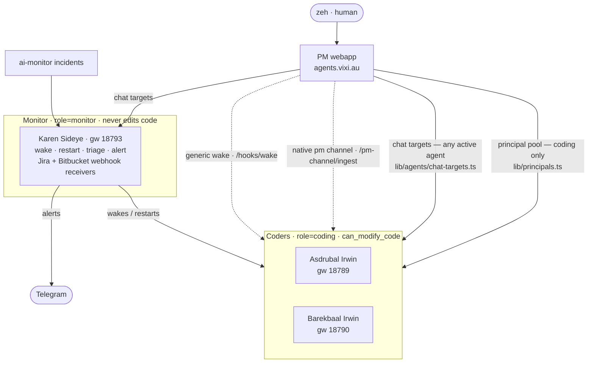

# ai/web — PM workspace

Single-host Next.js project manager for the OpenClaw agent fleet. Started as
the Stage 1 walking skeleton for
[HOMELAB-43](https://zeh-ferrari.atlassian.net/browse/HOMELAB-43); current
state is post-Stage-2 with the HOMELAB-46 dispatch seam wired, the
HOMELAB-52 agent control surface mounted on `/agents`, the HOMELAB-47
work item editor (Epic CRUD, attachments, principal pool, redesigned task
detail), and HOMELAB-48 on top of it (soft-delete + 7-day bin, taller
description editors, per-task/epic agent chat sidebar with one-shot
description-write grants). Since then: per-project tabs (Board · Epics ·
Library · Settings · Bin), project settings (repo path, git identity,
picker defaults, Done-card TTL), project soft-delete with its own 30-day
bin, direct per-agent chat with archive/continuation threads, and the
move of all chat/comment turns onto the native OpenClaw `pm` channel.
Most recently, agents can **propose work items** from a project-attached
direct chat — a grant-gated change-set of epics/tasks/sub-tasks the human
reviews and applies (propose → approve).

Served by one host-wide `pm.service` standalone Next process at
`agents.vixi.au` — see [deploy/README.md](./deploy/README.md). The legacy static `agents.html`
mission-control page (HOMELAB-42) sat next to this README until HOMELAB-52
folded it into the live `/agents` deck.

> **Naming.** The web UI is branded **Zero Latency** (workspace title)
> with a **Mission Control** subtitle and a `Z` mark. *PM* remains the
> internal codename everywhere else — the `pm.service` /
> `pm-consumer.service` units, the `pm-web` package, the `PM_*` env
> vars, and the OpenClaw `pm` channel — so the rename is display-only.

## Stack

Next.js 15 App Router · React 19 · Tailwind v4 · Prisma 6 / SQLite ·
NextAuth v5 (Credentials + argon2id) · `@dnd-kit` for the board ·
TypeScript strict, ESM-only.

## Local dev

```bash
pnpm install
cp .env.example .env
# edit DATABASE_URL / AUTH_SECRET as needed
pnpm prisma migrate dev   # applies committed migrations, regenerates client
pnpm dev
```

The Next.js app boots → `instrumentation.node.ts` seeds the `zeh` user
and runs the first agent sync against `$AGENT_INDEX_PATH` (default
`/srv/agents/index.json`). On a dev box where that file is absent, the
boot sync logs an error and continues — log in as `zeh` / `password1`
and rotate the password, then visit `/agents` to see the (empty) table.

Other useful scripts:

```bash
pnpm typecheck                                  # tsc --noEmit
pnpm lint                                       # next lint
pnpm sync:agents                                # one-shot agent sync
pnpm tsx scripts/seed.ts                        # idempotent dev seed
pnpm tsx scripts/pm-dispatch-receiver.ts all    # dispatch seam smoke
pnpm tsx scripts/pm-dispatch-integration.ts     # Slice 3 end-to-end smoke
pnpm tsx scripts/pm-consumer-replay-test.ts     # Slice 4 dedupe acceptance
pnpm tsx scripts/smoke-model-save.ts            # HOMELAB-52 model-save check
```

## Routes

| Route | Purpose |
| --- | --- |
| `app/login`, `app/rotate-password` | unauthenticated routes (forced rotation on first login). |
| `app/(app)/projects` | projects list + inline create. |
| `app/(app)/projects/bin` | project-level soft-delete bin — restores whole projects within the 30-day TTL. |
| `app/(app)/projects/[slug]` | kanban board (four workflow columns + a separate Backlog table, drag-and-drop, Backlog show/hide toggle); per-project tab bar (`project-tabs.tsx` in `layout.tsx`: Board · Epics · Library · Settings · Bin). Done cards older than `doneTtlDays` drop off the board. Task cards show the current workflow actor + `updated` time; Done cards show the reporter. |
| `app/(app)/projects/[slug]/tasks/[taskId]` | task editor — two-column. Main: inline title, description editor, sub-tasks, attachments, comments. Sidebar: status, assignee, reviewer, epic picker, parent, dates. |
| `app/(app)/projects/[slug]/epics` | epic list with status filter (open/done/archived) + inline create (title + description + Acting Manager picker, then redirects into detail for attachments). |
| `app/(app)/projects/[slug]/epics/[epicId]` | epic detail — assignee + acting manager (Epic keeps that label), status, attachments, tasks grouped by their own status, chat sidebar, Delete. |
| `app/(app)/projects/[slug]/library` | project library — every attachment under the project (task- + epic-anchored) in one list; excludes files whose parent is in the bin. |
| `app/(app)/projects/[slug]/settings` | project settings — repository path, default git identity, default assignee/reviewer for pickers, Done-card TTL, and project delete; plus a recent-activity agenda. For admin (`zeh`) on git/worktree-exposed projects, also a **Worktree live preview** switcher (build a worktree + flip which one `pm.service` serves; currently shared-service-scoped — see TODO). |
| `app/(app)/projects/[slug]/bin` | soft-delete bin — lists deleted Epics + Tasks with per-row Restore and "Restore + N children" actions. |
| `app/(app)/agents` | agents grid; merges PM DB rows with Atlas live snapshot. |
| `app/(app)/agents/[agent]` | per-agent deck — Atlas controls, profile editor, model settings. |
| `app/(app)/agents/[agent]/chat` | direct per-agent chat opened from the global sidebar CHAT section. |
| `app/(app)/system/activity` | system-wide ActivityLog stream. |
| `app/(app)/system/settings` | system-wide setting defaults. |
| `app/api/system/worktree-switch/status` | admin-only poll of the runner-maintained worktree-switch state (served worktree, inventory, current job). Drives the per-project **Worktree live preview** panel. |
| `app/api/auth/[...nextauth]` | NextAuth route. |
| `app/api/debug/sync` | manual trigger for the agent sync (auth-only). |
| `app/api/tasks/[id]/ack` | agent ack endpoint — auto To Do → In Progress, emits `task.ack_ready`. |
| `app/api/tasks/[id]/description` | agent description write-back. One-shot grant validated against the `allowDescriptionEdit` chat message. |
| `app/api/epics/[id]/description` | agent description write-back for Epics. Same one-shot model. |
| `app/api/agent/projects/[projectId]/proposals` | agent work-item proposal submission — grant-gated change-set (epics/tasks/sub-tasks + updates/comments), dry-run-validated and stored pending for human apply. Idempotent on `planId`. |
| `app/api/attachments/[id]` | streamed attachment download (auth-gated). |
| `app/api/agents/[agentId]/profile/...` | per-agent profile read/write (HOMELAB-52). |
| `app/api/agents/[agentId]/models` | model settings read/write. |
| `app/api/agents/[agentId]/services/{toggle,restart}` | Atlas service controls. |
| `app/api/agents/[agentId]/registry/toggle` | activate/deactivate registry entry. |
| `app/api/agents/[agentId]/integrations/credentials` | per-agent credential surface. |
| `app/api/agents/context/{task,epic,project}/[id]` | loopback-only live PM read API for agents; scoped `?grant=` URLs are preferred, with bearer fallback only while enabled. |
| `app/api/openclaw/pm-channel/stream` | token-scoped native PM channel live partial-reply callback from OpenClaw. |
| `app/api/openclaw/pm-channel/reply` | token-scoped native PM channel durable final-reply callback from OpenClaw. |
| `app/api/openclaw/pm-channel/events` | auth-gated same-origin SSE stream consumed by the browser while a reply is running. |
| `app/api/agents/[agentId]/chat/reply` | legacy token-scoped direct chat reply endpoint; native PM channel is the normal path. |
| `app/api/tasks/[id]/chat/reply` | legacy token-scoped task chat/comment reply endpoint; replies route back to the origin channel (chat vs comment). Native PM channel is the normal path. |
| `app/agents/avatars/[name]` | avatar proxy. |

Agent-facing callbacks are deliberately not browser-session routes.
`middleware.ts` lets token-scoped callbacks reach their route handlers:
native PM channel reply/stream callbacks use per-agent Bearer tokens,
live context reads use scoped context grants, legacy chat replies and
description writes use one-shot HMAC tokens, and project proposals use a
one-shot work-item grant token. Browser-only surfaces, including the SSE
`/api/openclaw/pm-channel/events` route, still require a signed-in PM
user.

## Library layout

| Path | Purpose |
| --- | --- |
| `lib/auth.ts`, `lib/auth-handlers.ts` | NextAuth credentials + JWT callbacks. |
| `lib/auth/password.ts` | argon2id hashing helpers. |
| `lib/auth/rate-limit.ts` | in-process login rate limit (per-IP + per-username). |
| `lib/agents/sync.ts` | the canonical agent sync — boot + periodic interval. |
| `lib/agents/index-loader.ts` | `/srv/agents/index.json` reader. |
| `lib/agents/credentials.ts` | per-agent host-private credential seeding. |
| `lib/agents/profile.ts` | shared agent profile read/write + ACL. |
| `lib/agents/model-settings.ts` | shared model-config store (HOMELAB-52). |
| `lib/agents/restart.ts` | systemd restart fan-out via Atlas gateway. |
| `lib/agents/seed-zeh.ts` | idempotent seeder for the `zeh` human user. |
| `lib/workflow.ts` | HOMELAB-44 rule library (transition / assignment / hierarchy / acting-manager). |
| `lib/principals.ts` | assignable-principal resolver — active humans + agents with `Agent.role='coding'`. Used by every Task/Epic picker. |
| `lib/agents/chat-targets.ts` | broader chat-only resolver — all active agents regardless of role (includes monitors). |
| `lib/agents/chat-actions.ts` | `sendAgentChatMessage` — persists the message, fires dispatch for task-scoped chats. |
| `lib/agents/context/` | PM-owned context packet builders for agent turns, including task/Epic snapshots, related activity, and cached attachment text extraction. |
| `lib/agents/context-grants.ts` | short-lived scoped grant URLs for loopback live-context reads; stores token hashes only. |
| `lib/agents/session-bindings.ts` | PM-owned conversation-to-OpenClaw session bindings for task/comment and direct chats. |
| `lib/agents/pm-channel-stream.ts` | native PM channel stream reducer and SSE framing for live + replayed partial replies. |
| `lib/agents/pm-channel-stream-log.ts` | durable append-only stream event log used to replay browser SSE after reconnect. |
| `lib/agents/pm-channel-runs.ts` | durable native PM channel run state (`queued`/`accepted`/`streaming`/`retryable`/`complete`/`failed`) used when the browser reconnects. |
| `lib/agents/pm-channel-jobs.ts` | durable PM-channel dispatch queue, retry worker, and queue health rollups. |
| `lib/agents/direct-chat-actions.ts` | direct agent chat actions for sidebar-launched conversations (send, archive, restart-from-archive). |
| `lib/agents/openclaw-pm-channel.ts` | native `pm` channel client — posts turns to `/pm-channel/ingest`, resolves per-agent Bearer tokens, types the reply-target envelope. |
| `lib/agents/effective-config.ts` | merges `/etc/openclaw/agent-defaults.json` (core → byRole → byIntegration → per-agent) into the effective capability/service view shown on the agent deck. |
| `lib/bin/actions.ts` | soft-delete + restore server actions for Task and Epic with cascade. |
| `lib/bin/purge.ts` | hourly hard-delete job for Task/Epic rows past the 7-day TTL; reclaims orphaned attachment blobs. |
| `lib/bin/purge-projects.ts` | hourly hard-delete job for Project rows past the 30-day TTL (`PM_PROJECT_BIN_TTL_DAYS`). |
| `lib/projects/actions.ts` | project settings write + soft-delete / restore server actions (`setProjectSettings`, `deleteProject`, `restoreProject`). |
| `lib/tasks/reorder.ts` | persists drag reorder of the board's `Task.rank` column. |
| `lib/epics/actions.ts` | Epic CRUD server actions (create/rename/assign/acting-manager/status). |
| `lib/work-items/proposal.ts` | agent work-item proposal change-set validator (create/update epics·tasks·sub-tasks·comments; `tmp:` temp-refs; validates project scope, active principals, hierarchy, and task-status transitions under human-triggered grant semantics). |
| `lib/work-items/apply.ts` | transactional commit core for an approved proposal (auth-free; topo-orders temp-refs, mirrors createTask/createEpic, attributes mutations to the agent). |
| `lib/work-items/actions.ts` | human apply/reject server actions wrapping the commit core (auth + revalidate). |
| `lib/agents/work-item-token.ts` | one-shot HMAC grant token for the proposal endpoint (mirrors `task-chat-token.ts`). |
| `lib/agents/context/project.ts` | project-environment context packet (repo path, git identity, defaults, existing epics/open tasks) + the planning prompt handed to the agent. |
| `lib/attachments/storage.ts` | filesystem write/read/delete under `/srv/Data/projects/<id>/attachments/<sha256>` (dev fallback `./.data/attachments`). |
| `lib/attachments/actions.ts` | upload/delete server actions; enforces XOR(taskId, epicId) target. |
| `components/agent-chat.tsx` | shared chat sidebar mounted on Task + Epic editors. |
| `components/chat-input.tsx` | direct-chat composer — message + Samba file uploads + project picker; human project-scoped messages automatically carry a one-shot proposal grant. |
| `app/(app)/agents/[agent]/chat/proposal-review.tsx` | review card for pending agent work-item proposals — per-op validation badges + Apply/Reject. |
| `components/streaming-agent-reply.tsx` | client SSE subscriber that renders the live reply bubble while OpenClaw is still generating. |
| `components/sortable-task-list.tsx` | `@dnd-kit` drag-reorder list used for sub-tasks / grouped task views, backed by `lib/tasks/reorder.ts`. |
| `components/activity-agenda.tsx` | compact recent-activity feed rendered on the project settings page. |
| `components/worktree-switcher.tsx` | admin live-preview switcher (shown in a git/worktree-exposed project's Settings via `lib/projects/worktree.ts::isWorktreeExposedRepo`): lists worktrees, polls switch state, requests a build+flip. |
| `lib/deploy/worktrees.ts` · `lib/deploy/actions.ts` | read the runner's switch `state.json` / write a switch `request.json`. The web app stays unprivileged; the build + restart happen in `pm-switch-runner` (as the monitor). See [deploy/MULTI_AGENT_WORKTREES.md](./deploy/MULTI_AGENT_WORKTREES.md). |
| `lib/activity.ts` | ActivityLog write helpers. |
| `lib/markdown.tsx` | server-side markdown renderer with safe-href allowlist + @mention resolver. |
| `lib/pm-events/` | shared `PmEvent` envelope (schema v1). |
| `lib/pm-dispatch/` | emitter side of the HOMELAB-46 dispatch seam — see [its README](./lib/pm-dispatch/README.md). |
| `lib/pm-consumer/` | consumer / dispatcher (OpenClaw-side service) — see [its README](./lib/pm-consumer/README.md). |
| `openclaw-pm-channel/` | external OpenClaw channel plugin that receives PM chat/comment turns, streams partial replies, and posts final replies back through the native channel lifecycle. |
| `lib/db.ts` | Prisma singleton. |
| `instrumentation.node.ts` | boot hook (Node runtime only); runs seed + first sync, then schedules the periodic agent sync and the two hourly purge jobs (Task/Epic bin + project bin). |
| `middleware.ts` | auth gate + `mustRotatePassword` redirect + forwarded-host handling. Excludes SSE routes to prevent Edge proxy response buffering. |
| `prisma/schema.prisma` | full schema (Stage 1 + Stage 2 + HOMELAB-46 delivery log). |
| `prisma/migrations/` | committed migration history; applied via `prisma migrate deploy`. |
| `deploy/` | systemd unit, nginx vhost, env file template. |

## Agent fleet

PM is the human-facing control plane for an OpenClaw agent fleet that
runs on the same host. The fleet uses an **exclusive two-role model**
(`/etc/openclaw/agent-defaults.json`: *every agent has exactly one role —
`coding` or `monitor`, never both*). Roles get different model tunings,
sudoers, Telegram bots, and operational guardrails; PM keys several of
its own behaviours off `Agent.role`.



**Coders (`role = coding`).** Asdrubal and Barekbaal. Capability
`can_modify_code`; they work Jira tickets, edit code, and push branches,
and never participate in monitoring. In PM they are the only agents in
the **assignable principal pool** (`lib/principals.ts`) — eligible as
Task assignee / reviewer and Epic assignee / acting-manager — and they
receive chat/comment turns over the native `pm` channel plus generic
`/hooks/wake` automation.

**Monitor (`role = monitor`).** Karen Sideye. Capabilities
`can_wake_agents`, `can_restart_agents`, `can_triage_incidents`, and
alerting to Telegram; she runs the inbound Jira + Bitbucket webhook
receivers (ports 3014 / 3015) and triages `ai-monitor` incidents, waking
or restarting coders as needed. Karen never modifies code, so she is
**excluded from the principal pool** — but she is reachable through the
broader chat-target resolver (`lib/agents/chat-targets.ts`), and her
`openclaw-control wake-agent` bridge is the degraded fallback PM uses
when a coder's gateway hooks are unavailable.

## Capability map

**Auth & identity.** Password-only (Credentials provider + argon2id). No
Google SSO in v1 — deferred to v1.1+. Seeded `zeh` plus one agent user
per `codeOwner`-matched entry in `/srv/agents/index.json`. Login rate
limit is in-process sliding-fixed-window: 10/5min per IP + 5/5min per
username. Forced password rotation on first login is enforced by
`middleware.ts`. Behind nginx the middleware uses `x-forwarded-host` to
keep the secure cookie + redirect host correct.

**Projects + board (Stage 2 / HOMELAB-44; board layout reworked in
HOMELAB-48).** Five verbatim task statuses — Backlog · To Do · In
Progress · Review · Done. The board renders the four workflow statuses
(To Do · In Progress · Review · Done) as drag-and-drop columns
(`@dnd-kit`); Backlog is a separate full-width table below the board
with a per-project localStorage show/hide toggle (hidden by default).
Dragging a backlog row onto a column moves the task into that status.
Backlog is a planning/opinion state: assigning or reassigning an agent
there sends the agent a task-context PM-channel turn and requires a
task-comment implementation plan/opinion, but does not authorize work.
`To Do` is the approval-to-execute state: the assigned agent must move
the task to `In Progress` and start immediately without posting a
visible acknowledgement unless there is new task information.
`Review` is reserved for completed implementation review; the resolved
reviewer moves satisfied work to `Done` without approval-only comments,
or leaves concise feedback/blockers while the task stays in `Review`.
Server-side enforcement lives in `lib/workflow.ts`:
`checkStatusTransition`, `checkAssignment`, `checkHierarchy`,
`checkActingManager`, plus the token-scoped
`POST /api/agent/tasks/[taskId]/workflow` endpoint for role-aware agent
actions (`start`, `ready_for_review`, `review_feedback`, `review_done`,
`triage_to_todo`; `submit_review` is a legacy alias for
`ready_for_review`). Client rolls back optimistic moves on rejection. Done
cards older than the project's `doneTtlDays` (default 5) are filtered
out of the board server-side so the column doesn't grow without bound.

**Project tabs, settings & library.** Every project is wrapped in a
shared layout (`app/(app)/projects/[slug]/layout.tsx`) carrying a tab
bar — Board · Epics · Library · Settings · Bin (`project-tabs.tsx`).
The **Settings** tab (`lib/projects/actions.ts::setProjectSettings`)
stores the repository path, default git user name/email used for agent
commits, default assignee + reviewer that seed Task pickers, and the
`doneTtlDays` board cutoff; it also hosts project delete and a recent
`ActivityLog` agenda (`components/activity-agenda.tsx`). The **Library**
tab lists every `Attachment` under the project (task- and epic-anchored
alike, since `Attachment.projectId` is a direct FK), skipping files
whose parent is in the bin. Projects are created inline from the
projects list (`createProject`).

**Tasks (HOMELAB-44 + HOMELAB-47).** Self-referential `Task` model (no
parallel `SubTask`) — a sub-task is a `Task` with `parentTaskId` set.
The editor is two-column: main pane has inline title, markdown
description, sub-tasks, attachments, and comments (`@mention` resolved
through `lib/markdown.tsx`); sidebar has status, assignee, **Reviewer**
(UI label only — the schema column stays `actingManagerId` and the
audit kind stays `task.acting_manager` so the activity feed is
unchanged), epic picker (with "No epic"), parent task link, and a
created/updated dates panel. Tasks may live without an Epic; an Epic
and its tasks can be assigned to different principals and the task
keeps its own kanban status independent of the Epic's
open/done/archived status. All mutations write `ActivityLog`.

**Epics (HOMELAB-47).** `/projects/<slug>/epics` is a status-filtered
list with inline create; `/projects/<slug>/epics/<id>` is the detail
view. Epics have a single human owner field labelled **Acting manager**
(no Reviewer concept at the Epic level), plus an Assignee, status,
description, attachments, and a tasks panel grouped by each task's own
kanban status. Tasks linked into an Epic still drive their workflow
from the project board.

**Attachments (HOMELAB-47).** Files attached to a Task XOR an Epic;
metadata in the `Attachment` table, bytes on disk under
`/srv/Data/projects/<id>/attachments/<sha256>` (dev fallback
`./.data/attachments/<id>/<sha256>`). Content-addressed: re-uploading
the same bytes reuses the existing blob. Size cap is 25 MiB by default,
tunable via `PM_ATTACHMENT_MAX_BYTES`. Downloads go through
`GET /api/attachments/[id]` with the original filename via
`Content-Disposition`.

**Principal pool.** `lib/principals.ts` is the single resolver every
picker calls — active human Users plus Users whose linked `Agent.role`
is `coding` and not deactivated. Non-coding agents and remote-host
agents that aren't seeded as PM users are intentionally excluded.

**Soft delete + bin (HOMELAB-48).** `deleteTask` / `deleteEpic` stamp
`deletedAt` + `deletedById` and cascade to non-deleted children (Epic
→ tasks → sub-tasks; Task → sub-tasks). Every active-view query
filters `deletedAt: null`. `/projects/<slug>/bin` lists everything in
the bin with per-row Restore plus an optional "Restore + N children"
button that restores rows that share the parent's exact `deletedAt`
timestamp (so only children deleted by THIS cascade come back; rows
deleted independently before/after stay in the bin). The hourly
`purgeBin` job in `instrumentation.node.ts` hard-deletes rows past the
TTL (`PM_BIN_TTL_DAYS`, default 7); orphaned attachment blobs are
swept via `lib/attachments/storage.ts`. Whole **projects** soft-delete
on the same model into a separate, longer-lived bin: `deleteProject`
stamps `Project.deletedAt`, `/projects/bin` restores them, and a second
hourly job (`purgeProjectBin`, `PM_PROJECT_BIN_TTL_DAYS`, default 30)
hard-purges the aged ones.

**Agent chat (HOMELAB-48).** Task and Epic editors mount a chat
sidebar (`components/agent-chat.tsx`). The agent picker uses
`lib/agents/chat-targets.ts` — broader than the principal pool so
monitors are reachable. Messages persist as `AgentChatMessage` rows
keyed by (taskId|epicId, agentSlug); message bodies render as full
markdown (`lib/markdown.tsx::renderFullMarkdown`). Human-authored task
and Epic chat messages automatically carry a one-shot description write
capability. The capability is a token-scoped endpoint in the native
channel prompt, and agents are instructed to call it only when the
current human message directly asks to update, rewrite, reformat, or
replace the description.
Per-message Delete
hard-removes the row (chats don't go through the bin); an audit row
records who/when. Task-scoped chats are sent directly to the native
OpenClaw `pm` channel on the target agent's loopback gateway
(`/pm-channel/ingest`); Epic-scoped chats use the same native channel
with an `epic-chat` reply target. Agent replies return only to the
origin channel: messages started in task chat stay in task chat,
messages started in Epic chat stay in Epic chat, and messages mirrored
from task comments are posted back as task comments.
Task chat, Epic chat, and task-comment turns still use the PM context
builders in `lib/agents/context/`: the current turn is kept explicit,
recent Discussion/comments are included in the prompt, and scoped
context grant URLs let the agent fetch full live task/Epic/project state
when needed. Every task + agent conversation gets an
`AgentSessionBinding`; its
`openclawSessionKey` is the base for PM channel routing. Direct chats
use the stable key for continuity; task, Epic, and task-comment turns
derive a per-message key so stale or oversized OpenClaw transcripts do
not carry into the next PM request. PM also writes a `PmChannelRun` row
for each local handoff so the browser can reconnect to
accepted/streaming/failed state without a polling refresh loop.
Visible replies are only for useful contributions: plans, action
results, feedback, blockers, or necessary questions. If an agent has no
new information to add, it replies with the `PM_SILENT_NO_CONTRIBUTION`
sentinel; `/api/openclaw/pm-channel/reply` records a silent completion
activity row and creates no chat/comment bubble. A bare stream `done`
without a saved reply, workflow action, or silent completion is recorded
as failed so the chat UI does not wait indefinitely.

**Direct agent chat.** `/agents/<slug>/chat` opens a sidebar-launched
conversation with one agent. Sending a direct message persists it,
then schedules native `direct` dispatch work so the browser can show the
human message immediately while context building and gateway handoff run
off the submit path. The normal transport is the PM-channel bus
(`PM_CHANNEL_BUS_SOCKET`, `PM_CHANNEL_BUS_DROP_DIR`, or
`PM_CHANNEL_BUS_HTTP_URL`); direct HTTP remains available only as the
explicit `PM_OPENCLAW_CHANNEL_HTTP_FALLBACK=1` fallback.
OpenClaw records the session, streams partial reply chunks back to
`POST /api/openclaw/pm-channel/stream` for the live browser projection,
and delivers the durable final reply back to
`POST /api/openclaw/pm-channel/reply` with the shared PM channel token.
The browser listens to `/api/openclaw/pm-channel/events` for live stream
frames and reconciles active direct-chat rows through
`GET /api/agents/<slug>/chat/messages`; that lightweight reconcile path
replaces full-page polling after missed or late final stream events. To
ensure responsive streaming, `/api/openclaw/pm-channel/events` is
excluded from middleware proxy buffering.

The UI supports several key enhancements:
- **Send Box & Keyboard Shortcuts**: Fixed at the bottom of the layout. Pressing `Enter` sends the message immediately; `Shift+Enter` inserts a newline.
- **Collapsible Sidebar**: The archive sidebar can be toggled using an icon button at the top-right of the chat header (persisted in `localStorage`).
- **Interactive Calendar & Lineage**: The sidebar includes a monthly calendar displaying highlight indicators on dates with active chats, syncing on hover. Clicking on a highlighted date filters the list to show only conversations from that day. Archive cards in the sidebar are designed to be extremely compact, displaying dates in a modern format (e.g., `Today · 15:30` or `25 May · 15:30`), along with paperclip attachment indicators, cumulative message counts, and total memory sizes in KB. Relationships are no longer displayed on the cards; instead, viewing an archive with parents displays a **Chat Initial Context** button at the top of the chat which dynamically prepends the parent conversation history each time it is clicked, showing **Chat Start...** once the oldest ancestor is reached. Parent archives with active continuation children cannot be deleted.
- **Smart Scroll**: When sending or receiving messages, the chat auto-scrolls. If a message is taller than the viewport, the top of the message is aligned with the top of the chat area.
- **Samba Attachments**: Supports file uploads inside the compose box. Selected files are uploaded and saved to the agent's Samba drive under `/srv/samba/shared/[agent]/chats/[chatId]/`. Supported text-like attachments have their content extracted and appended as context when the current message uploads files or asks for attachment/file context; set `PM_DIRECT_CHAT_ALWAYS_INCLUDE_FILES_CONTEXT=1` to restore unconditional file-context inclusion. Deleting an archive automatically purges its uploads folder.

OpenClaw exposes the selected thinking budget and run metadata inside a collapsible `<details>` panel, not private chain-of-thought text. To keep reply latency down, the PM channel context includes a bounded recent transcript and bounded parent-archive excerpt (`PM_DIRECT_CHAT_CONTEXT_MESSAGES`, `PM_DIRECT_CHAT_ARCHIVE_CONTEXT_MESSAGES`, `PM_DIRECT_CHAT_ARCHIVE_CHAIN_LIMIT`). Direct-chat warm-pool keys are agent-scoped, so starting a new chat does not force a cold warm-agent miss; Task/Epic warm entries remain scoped to their task/Epic thread. Slow accepted-to-first-stream runs emit `pm.channel.latency_warning` activity rows when they exceed `PM_OPENCLAW_FIRST_STREAM_WARNING_MS` (default `15000`). Because PM and OpenClaw run on the same host, channel callbacks default to `http://127.0.0.1:3000`; set `PM_AGENT_CALLBACK_URL` or `PM_INTERNAL_APP_URL` to override that.

**Agent work-item proposals.** A direct chat (`/agents/<slug>/chat`) can
be attached to a project, and Task/Epic Action Plan messages plus
human-authored task comments are already project-scoped. Every
human-authored project-scoped turn in those surfaces becomes a
planning-capable turn by default: PM hands the agent the project
environment (repo path, git identity, picker defaults, existing epics/open
tasks and their descriptions via `lib/agents/context/project.ts`) plus a
single-use HMAC grant + the propose endpoint. Direct project chats also
receive short-lived context-read grant URLs, and PM detects same-project
Task/Epic links in the human message so agents can fetch those item
contexts over loopback instead of opening the public browser URL. In
Task/Epic Action Plan and task-comment turns, that single-use stamp is tracked per addressed
agent, so an `All Coders` message or multi-agent task comment can let
each coder submit one proposal. Agent-authored comments and PM workflow
notifications do not grant work-item management. The prompt tells the
agent to submit a proposal only when the current human message directly
asks for project work-item changes. The agent POSTs a typed change-set to
`POST /api/agent/projects/<id>/proposals` — it never writes the board
directly. That route is token-scoped and intentionally bypasses browser
session middleware; the route handler validates the grant, token, active
agent, project binding, and single-use stamp. PM dry-run-validates every
op under human-triggered grant semantics (active principals, project
scope, hierarchy, known statuses, and valid task-status transitions; new
tasks land in Backlog, new epics open) and stores a pending
`WorkItemProposal`. The human reviews it in the chat
(`proposal-review.tsx`) and clicks Apply — the whole change-set commits in
one transaction (`lib/work-items/apply.ts`), attributed to the agent in
`ActivityLog`, with the approval recorded by `WorkItemProposal.appliedById`
+ a `workitem.proposal.apply` row — or Reject. `@unique(planId)` makes a
re-submitted proposal idempotent. Full contract:
[docs/agent-interaction.md](./docs/agent-interaction.md).

**Agents dashboard.** `/agents` merges the PM `Agent` table with the
Atlas live snapshot at `http://127.0.0.1:3013/agents/snapshot` (busy /
idle / model / current ticket / host services). KPI strip shows agents
online, open tickets, open PM tasks, host services, and open sensor
alerts. The hub renders Mission Control actions from `ActivityLog`
(`agent.service.*`, `agent.registry.*`, `agent.integration.*`,
model/profile/restart rows) plus live signals/sensors from the Atlas
monitor snapshot. `/agents/[slug]` mounts the Atlas controls deck (service
toggle/restart, registry toggle), the model settings editor, and the
profile editor. Profile + model writes go through
`lib/agents/profile.ts` / `lib/agents/model-settings.ts`, are
audit-logged on `ActivityLog` with `targetAgent` + `targetFile`, and
trigger a restart via `lib/agents/restart.ts` so live agents pick up
changes.

**PM → agent dispatch seam (HOMELAB-46).** Workflow rules run first; a
post-persist `notifyDispatch(event)` then emits a typed `PmEvent` envelope
(schema v1) over a configurable driver:

| Driver | Selected via | Notes |
| --- | --- | --- |
| `unix-socket` (default) | `PM_DISPATCH_DRIVER=unix-socket` + `PM_DISPATCH_SOCKET` | NDJSON over AF_UNIX, primary per HOMELAB-45. |
| `file-drop` | `PM_DISPATCH_DRIVER=file-drop` + `PM_DISPATCH_DROP_DIR=/var/lib/pm/drop` | one JSON file per envelope, atomic rename. |
| `http-localhost` | constructed directly via `createHttpLocalhostDriver({ url })` — **not** env-selectable | loopback + Bearer; tests / explicit callers only. |

`notifyDispatch` is the only call-site entry point and never throws —
transport/config/disabled paths all resolve to a `DispatchResult` so a
failed send never affects the rule outcome. With no driver env set, it
short-circuits as `{ ok: false, skipped: "disabled" }`. Consumer side
(`lib/pm-consumer/`) runs as a separate `tsx` process on the OpenClaw
host: dedupes by `${kind}:${task.id}:${event.id}` against the
`PmEventDelivery.dedupeKey` unique index, resolves the target agent's
gateway port, and wakes the local gateway with
`POST http://127.0.0.1:<port>/hooks/wake` plus that agent's Bearer
token for non-chat automation. Direct chat, Discussion, Epic chat, and
task-comment turns bypass this consumer path and enter OpenClaw through the native `pm` channel at
`POST http://127.0.0.1:<port>/pm-channel/ingest`. OpenClaw gateway
configs must still set `hooks.allowRequestSessionKey=true` and
`hooks.allowedSessionKeyPrefixes=["hook:", "pm:"]` for generic PM wakes.
OpenClaw requires `hook:` when no hook default session key is configured;
PM-owned sessions use the `pm:` prefix. On this single-host install,
every agent gateway should be bound to loopback, so `/hooks/wake` and
`/pm-channel/ingest` are only reachable from this computer.
Karen's
`openclaw-control wake-agent` bridge at `/usr/local/sbin/pm-karen-wake-agent`
is a degraded fallback for hosts that have not enabled gateway hooks or
for temporary gateway hook failures; the fallback passes the same
`--session-key <pm:...>` through `openclaw system event`.
Karen's PM workflow drift fallback uses `/usr/local/sbin/pm-workflow-nudge`
instead. That helper re-enters the native `pm` channel so the target agent
gets the full Mission Control context packet, workflow endpoint capability,
and task-comment reply target instead of a generic heartbeat reminder.
Truncating `PmEventDelivery` is safe — audit rows live independently on
`ActivityLog`.

## Agent runtime contract

Direct PM chat, task chat, task-comment, and Epic chat turns now use the
native OpenClaw `pm` channel, not the legacy prompt-visible callback
contract.
The full agent-facing guide lives in
[docs/agent-interaction.md](./docs/agent-interaction.md).

When a user sends a direct chat message, task chat message, Epic chat
message, or task comment that targets an agent, PM:

1. Persists the PM-side row (`DirectAgentChatMessage`, `AgentChatMessage`,
   or `Comment` plus mirrored `AgentChatMessage` for comment origins).
2. Resolves an `AgentSessionBinding`, derives the channel session key
   for that surface, records a durable local run/job, and sends or queues
   the turn for the target agent gateway:
3. Builds bounded channel guidance for the current turn off the direct
   chat submit path. Task/Epic chat prompts include the recent hot path
   plus scoped live-context grant URLs; smaller workflow/comment paths may
   still include compact inline context.

```json
{
  "version": 1,
  "kind": "direct | task-chat | task-comment | epic-chat",
  "agentSlug": "asdrubal",
  "sessionKey": "pm:...",
  "text": "<latest user message>",
  "contextText": "<compact PM context packet or null>",
  "systemPrompt": "<channel guidance>",
  "actor": { "id": "usr_...", "username": "zeh", "kind": "human" },
  "replyTarget": { "kind": "direct | task-chat | task-comment | epic-chat", "...": "origin metadata" },
  "callbackUrl": "http://127.0.0.1:3000/api/openclaw/pm-channel/reply",
  "streamUrl": "http://127.0.0.1:3000/api/openclaw/pm-channel/stream"
}
```

The target gateway verifies the per-agent PM channel Bearer, runs the
OpenClaw channel turn kernel, records the turn in the supplied `pm:`
session, streams partial visible text to `/api/openclaw/pm-channel/stream`,
and posts the durable final answer to `/api/openclaw/pm-channel/reply`.
PM writes the final answer only to the origin channel: direct chat stays
direct, task chat stays task chat, Epic chat stays Epic chat, and
task-comment replies become task comments. PM records the turn in
`PmChannelRun` before contacting the gateway and updates it from stream
and reply callbacks. Stream events are appended with monotonically
increasing sequence numbers, so browser SSE clients can reconnect with
`Last-Event-ID` and replay missed frames. For Task/Epic Discussion
work-item grants, `PmChannelRun.workItemGrantUsedAt` is the per-agent
consumption stamp.

`/hooks/wake` remains installed for generic PM events such as assignment
and ack-ready automation. It is no longer the normal chat/comment path.
The same-host Karen bridge remains only as a degraded fallback for old
hosts or temporary gateway hook failures.

`openclaw/install.sh` is the host install path for the PM/OpenClaw
integration. With a PM checkout present it must:

- Ensure `PM_DISPATCH_SOCKET` (or `PM_DISPATCH_DROP_DIR=/var/lib/pm/drop`)
  on the PM host matches the consumer side for non-chat PM events.
- Install and enable the one host-wide `pm.service` and `pm-consumer.service`
  as system services with runtime `User=` / `Group=` set to the configured
  PM app user/group (`karen` on x1 by default). These are **not**
  per-agent user units; stale
  `/home/<agent>/.config/systemd/user/pm*.service` files should be
  removed so a coding agent cannot accidentally own the PM port or
  consumer.
- Ensure the PM app user can traverse/read the checkout and standalone
  bundle and can write `prisma/`, `.data/`, `/var/lib/pm/drop`, and
  `/etc/openclaw/pm-agent-credentials`.
- Ensure production attachment storage exists and is writable by the PM
  app user: `/srv/Data/projects` for task/Epic attachments and
  `/srv/samba/shared` (plus child agent share directories) for direct-chat
  Samba uploads. The service sandbox must include both paths.
- Provision service-private `pnpm` home/config/cache directories for
  `pm-consumer.service` under `/var/lib/pm` and point `HOME`,
  `XDG_CONFIG_HOME`, `XDG_CACHE_HOME`, `PNPM_HOME`, and
  `NPM_CONFIG_USERCONFIG` there. This keeps `ProtectHome=true` without
  noisy `/home/<pm-user>/.npmrc` warnings.
- Enable the external hook surface in every enabled agent gateway config
  under `/srv/agents/openclaw/<slug>/openclaw.json`:
  `gateway.bind="loopback"`, loopback trusted-proxy config,
  `hooks.enabled=true`, `hooks.path="/hooks"`, and a per-agent
  `hooks.token`. Also set `hooks.allowRequestSessionKey=true` and
  `hooks.allowedSessionKeyPrefixes=["hook:", "pm:"]` so PM can route
  direct chats and per-message PM turns through OpenClaw while preserving
  OpenClaw's required hook-session prefix. Preserve existing
  `hooks.internal` config. Each runtime
  `/home/<slug>/.openclaw/openclaw.json` should be a symlink to the
  `/srv/agents/openclaw/<slug>/openclaw.json` file; otherwise PM model
  edits and gateway reads can diverge.
- Mirror those same Bearer tokens into `PM_CONSUMER_HOOK_TOKEN_FILE`
  (default `/etc/openclaw/pm-consumer-tokens.json`) as a JSON object
  keyed by agent slug. The file should be readable by the PM consumer
  service group only (`0640`) and should not be committed or logged.
- Stage the native PM channel plugin at
  `/usr/local/share/openclaw/plugins/pm-channel`, link it into each
  agent's OpenClaw config, generate per-agent PM channel Bearer tokens
  in `/etc/openclaw/pm-channel-tokens.json`, and set the plugin's final
  reply callback URL to
  `http://127.0.0.1:3000/api/openclaw/pm-channel/reply`.
- Apply the OpenClaw session-fence runtime patch via
  `/usr/local/sbin/openclaw-patch-session-fence`. This keeps primary
  model timeout markers from masking the provider timeout as a local
  session takeover, which allows configured model fallbacks to run.
- Leave the streaming callback as PM-owned per-turn data. PM derives
  both `callbackUrl` and `streamUrl` from `PM_AGENT_CALLBACK_URL` or
  `PM_INTERNAL_APP_URL`, defaulting to `http://127.0.0.1:3000`.
- Restart each `openclaw-gateway.service` after changing hook config.
  Expected local checks are: `GET /health` returns 200,
  `GET /hooks` returns 405, unauthenticated `POST /hooks/wake` returns
  401, and `HEAD /pm-channel/ingest` returns 405.
- Ensure nginx dashboard upstreams use `127.0.0.1:<gateway_port>` and
  block prefixed hook/channel paths such as `/<agent>/hooks` and
  `/<agent>/pm-channel`; gateway ports should not listen on the LAN.
- Keep the Karen bridge installed for hook outages or older hosts:
  `/usr/local/sbin/pm-karen-wake-agent` should call
  `sudo -n -u karen sudo -n /usr/local/sbin/openclaw-control wake-agent ...`,
  and sudoers should allow the PM consumer user to execute that helper
  without a password.

This repo's `deploy/pm.env.example` carries the PM-host side, and
`deploy/pm-consumer.service` carries the file-drop consumer side. The
OpenClaw installer should create `/var/lib/pm/drop` and install/start
the consumer service when the PM checkout is present.

## Schema highlights

`prisma/schema.prisma` is the source of truth. Key tables:

- `User` / `RolePermission` / `PasswordResetToken` — auth and identity.
  `User.kind` is `"human" | "agent"`; agent users link to `Agent` via
  `agentId`.
- `Agent` — system-managed mirror of `/srv/agents/index.json`. Carries
  slug, role, `codeOwner`, `gatewayPort`, last-seen `rawJson`, and a
  `deactivatedAt` tombstone.
- `Project` / `ProjectMember` / `Epic` / `Task` / `Comment` — board
  data. `Task` is self-referential for sub-tasks; status uses verbatim
  labels (no Jira aliases); `Project.readmePath` points at
  `/srv/Data/projects/<id>/README.md` on the host filesystem. `Project`
  also carries settings columns (`repositoryPath`,
  `defaultGitUserName`/`Email`, `defaultAssigneeId`, `defaultReviewerId`,
  `doneTtlDays`) and its own soft-delete pair (`deletedAt` +
  `deletedById`, 30-day bin) plus an `archivedAt` tombstone. `Epic`
  carries its own `assigneeId` + `actingManagerId` (HOMELAB-47) —
  independent of any task's principals or status.
- `Attachment` (HOMELAB-47) — file metadata for task/epic uploads.
  XOR(taskId, epicId) is enforced server-side. Content-addressed via
  `sha256`, indexed for de-duped GC.
- `AttachmentExtract` — cached text extraction for agent context,
  keyed by `(sha256, extractorVersion)` so duplicate uploads reuse the
  same bounded text excerpt.
- `AgentSessionBinding` — PM-owned mapping from `(scopeType, scopeId,
  agentSlug)` to an OpenClaw session key. Direct chat uses this stable
  key for continuity; task/comment/Epic channel turns derive a
  per-message key from it so each request starts with a clean channel
  transcript while PM supplies the current turn guidance and live-context
  grant URLs.
- `Task.deletedAt` / `Epic.deletedAt` + `deletedById` (HOMELAB-48) —
  soft-delete columns. `deletedAt != null` means in the bin; the value
  is also the cascade-batch anchor and the 7-day purge anchor.
- `AgentChatMessage` (HOMELAB-48) — chat thread per (taskId|epicId,
  agentSlug). Carries `allowDescriptionEdit` and `editGrantUsedAt` for
  the one-shot agent description write-back grant, plus
  `allowWorkItemManagement` for human-triggered Discussion proposal
  grants. Per-addressed-agent proposal grant consumption is tracked on
  `PmChannelRun`. `originChannel` / `originCommentId` keep replies in
  the user's original channel. The task Comments tab renders live
  task-comment bubbles from `PmChannelRun` state only while the turn is
  still active and relevant to the task's current workflow owner/status;
  failed, completed, or orphaned workflow notifications are settled
  instead of showing an endless live reply bubble.
- `DirectAgentChatMessage` / `DirectAgentChatArchive` — sidebar direct
  chat. Active messages carry `archiveId` (null while live) and
  `baseArchiveId` (the frozen archive a continuation builds on). An
  archive freezes a transcript with a `summary`, period, `messageCount`,
  and an optional `parentArchiveId` linking continuation chains; archives
  soft-delete via their own `deletedAt`. Gains `projectId` (attached
  project), `allowWorkItemManagement` (per-message work-item grant), and
  `workItemGrantUsedAt` (single-use stamp).
- `WorkItemProposal` — agent work-item proposals (propose → approve). One
  row per submitted change-set: `operations` (JSON), `validation`
  (dry-run snapshot), `status` (`pending|applied|rejected`), `agentSlug` +
  `proposedByUserId`, `appliedById` / `rejectedById`, and
  `@unique(planId)` for idempotency.
- `ActivityLog` — audit trail. `targetAgent` + `targetFile` keep
  agent-control-surface rows independent of project/task lifecycles.
- `PmEventDelivery` (HOMELAB-46 Slice 4) — consumer-side delivery log.
  `@unique(dedupeKey)` drives the replay-test idempotency property.

Migrations under `prisma/migrations/`:

- `20260521081126_init` — Stage 1 baseline.
- `20260521115507_homelab44_stage2_schema` — sub-tasks, project README
  path, verbatim status labels.
- `20260521194341_homelab44_acting_manager` — `Task.actingManagerId`.
- `20260521233000_homelab52_profile_audit` — `ActivityLog.targetAgent` /
  `targetFile` indexes for the profile-editor audit trail.
- `20260522080000_homelab46_pm_event_delivery` — `PmEventDelivery`.
- `20260522112410_homelab47_epics_attachments` — Epic assignee +
  acting-manager, `Attachment` table.
- `20260522121913_homelab48_bin_and_chat` — `Task.deletedAt` /
  `Epic.deletedAt` (+ `deletedById`), `AgentChatMessage` table.
- `20260523094600_direct_agent_chat` — `DirectAgentChatMessage` table.
- `20260523095234_homelab_project_settings_and_task_extras` — `Project`
  settings columns, soft-delete + `archivedAt`, `Task` extras.
- `20260523111000_direct_agent_chat_archives` — `DirectAgentChatArchive`
  + message `archiveId`.
- `20260523123000_direct_agent_chat_child_archives` — `baseArchiveId` /
  `parentArchiveId` for continuation chains.
- `20260524103000_agent_chat_origin_channel` —
  `AgentChatMessage.originChannel` / `originCommentId` so agent replies
  return only to the channel where the user started the exchange.
- `20260524124500_attachment_extracts` — `AttachmentExtract` cache for
  PM-owned agent context packets.
- `20260524133000_agent_session_bindings` — `AgentSessionBinding`
  table for PM-owned OpenClaw session routing.
- `20260525081816_agent_work_item_proposals` — `WorkItemProposal` table +
  `DirectAgentChatMessage.projectId` / `allowWorkItemManagement` /
  `workItemGrantUsedAt` for project-attached agent planning.
- `20260526172000_discussion_work_item_grants` — Task/Epic Action Plan
  messages and human-authored task-comment wakes can carry
  human-triggered work-item proposal grants.
- `20260526173500_pm_channel_run_work_item_grants` —
  `PmChannelRun.workItemGrantUsedAt` tracks Discussion proposal grant
  consumption per addressed agent.
- `20260530180000_asdrubal_p0_kernel` — durable PM-channel jobs,
  replayable stream events, scoped context grants, and per-run stream
  sequence tracking.

## Environment

See `.env.example` for the full list. Highlights:

- `DATABASE_URL` — `file:./pm.db` for dev; Prisma resolves it relative
  to `prisma/schema.prisma`, landing the file at `prisma/pm.db`. Production
  must use an absolute path outside the worktree, e.g.
  `file:///srv/Data/pm/pm.db`; use `deploy/move-sqlite-db.sh` for the
  controlled backup + `VACUUM INTO` relocation. Live worktree previews
  override this with `/srv/Data/pm/wt-<branch>.db` through the active
  systemd drop-in.
- `AUTH_SECRET` — `openssl rand -base64 32`.
- `AUTH_TRUST_HOST=true` — required behind nginx.
- `APP_URL` — public URL, used for cookies + reset links.
- `AGENT_INDEX_PATH` — host descriptor (default `/srv/agents/index.json`).
- `AGENT_CREDENTIALS_DIR` — per-agent seed-credential dir (mode 0600).
- `AGENT_SYNC_INTERVAL_MIN` — periodic sync cadence (minutes).
- `PM_DISPATCH_DRIVER`, `PM_DISPATCH_SOCKET`, `PM_DISPATCH_DROP_DIR` —
  dispatch seam selection / endpoints (`lib/pm-dispatch/README.md`).
- `PM_CONSUMER_SOCKET`, `PM_CONSUMER_DROP_DIR`,
  `PM_CONSUMER_HTTP_PORT`, `PM_CONSUMER_HTTP_TOKEN`,
  `PM_CONSUMER_HOOK_TOKEN_*` / `PM_CONSUMER_HOOK_TOKEN_FILE` —
  consumer side (`lib/pm-consumer/README.md`).
- `PM_ATTACHMENT_ROOT` — override the on-disk root for attachments.
  Defaults to `/srv/Data/projects` in production and
  `<cwd>/.data/attachments` otherwise.
- `PM_ATTACHMENT_MAX_BYTES` — per-file size cap, default 25 MiB.
- `PM_AGENT_CONTEXT_ATTACHMENT_TEXT_MAX_BYTES` — max bytes read from a
  text-like attachment for inline agent context, default 96 KiB.
- `PM_BIN_TTL_DAYS` — Task/Epic soft-delete retention, default 7.
- `PM_PROJECT_BIN_TTL_DAYS` — project soft-delete retention, default 30.
- `PM_BIN_PURGE_INTERVAL_MIN` — purge job cadence, default 60 (drives
  both the Task/Epic and project purge jobs).
- `PM_OPENCLAW_CHANNEL_TOKEN` / `PM_OPENCLAW_CHANNEL_TOKEN_FILE` — shared
  fallback + per-agent JSON map of native `pm` channel Bearer tokens
  (the file wins per slug).
- `PM_OPENCLAW_CHANNEL_INGRESS_PATH` — gateway ingest path, default
  `/pm-channel/ingest`.
- `PM_OPENCLAW_CHANNEL_TIMEOUT_MS` — ingest post timeout, default 5000.
- `PM_CHANNEL_BUS_SOCKET`, `PM_CHANNEL_BUS_DROP_DIR`,
  `PM_CHANNEL_BUS_HTTP_URL` — bus-first native PM-channel dispatch.
  Production/file-drop previews set `PM_CHANNEL_BUS_DROP_DIR` to the same
  directory as `PM_CONSUMER_DROP_DIR` (default `/var/lib/pm/drop`) so
  `pm-consumer` can deliver `openclaw.pm_channel_turn` envelopes to each
  agent's `/pm-channel/ingest` endpoint. At least one bus setting is
  required when async native PM-channel dispatch is enabled.
- `PM_INTERNAL_APP_URL` / `PM_AGENT_CALLBACK_URL` — loopback base PM
  hands to OpenClaw for the reply + stream callbacks, default
  `http://127.0.0.1:3000`. PM records send→accepted→first-token→final
  spans in `PmChannelRun` timestamps and surfaces them on the Agents and
  System Activity views alongside SQLite page/freelist/journal/locking
  health.
- `PM_ASYNC_DISPATCH`, `PM_ASYNC_DISPATCH_INLINE_NUDGE`,
  `PM_CHANNEL_JOB_MAX_ATTEMPTS`, `PM_CHANNEL_WORKER_POLL_MS` — enable
  and tune the durable native PM-channel queue/worker. Async dispatch
  relies on the in-process poll loop or an external `pm-channel-worker`
  process to retry jobs after backoff.
- `PM_CONTEXT_GRANTS_REQUIRED`, `PM_CONTEXT_GRANT_TTL_MS`,
  `PM_CONTEXT_GRANT_MAX_USES`, `PM_CONTEXT_GRANT_MAX_BYTES` — control
  scoped live-context grant enforcement and limits.
- `PM_DIRECT_CHAT_CONTEXT_MESSAGES`,
  `PM_DIRECT_CHAT_ARCHIVE_CONTEXT_MESSAGES`,
  `PM_DIRECT_CHAT_ARCHIVE_CHAIN_LIMIT` — bounds on the direct-chat
  context packet (recent transcript + archive excerpt + chain depth).

## Deployment

Manual bootstrap on `agents.vixi.au`; the full playbook lives in
[deploy/README.md](./deploy/README.md). After Stage 1:

- Schema changes — generate with `pnpm prisma migrate dev --name <change>`
  locally, commit the new migration dir, roll forward on the host with
  `pnpm prisma migrate deploy`. Never `db push` against the production DB.
- The PM webapp and the `pm-consumer` process restart independently —
  Slice 4 does not require rebuilding Next when only the consumer changes.

## Background / spikes

- `docs/spikes/HOMELAB-45-transports/` — transport selection memo and
  bench harness that picked AF_UNIX as primary with the file-drop
  fallback used here.
- `docs/agent-interaction.md` — agent-facing PM interaction contract,
  including task chat/comment callbacks and future write actions.

## Known follow-ups

- Email send for `password_reset_tokens` (schema exists; sender deferred
  to v1.1 polish).
- Permission enforcement on top of the `RolePermission` stub.
- A PM-visible task key separate from `task.id` (HOMELAB-46 commentId
  12265 — current dispatch envelopes assert `task.key === task.id`,
  which the Slice 3 integration smoke pins).
- OpenClaw-side AF_UNIX listener for `PM_DISPATCH_SOCKET` remains an
  optional transport optimization. Live agent wake on the single-host
  install depends on the file-drop/socket consumer plus each agent's
  local `/hooks/wake` endpoint.

## Review notes (2026-05-22)

Snapshot read of the codebase from a passing reviewer. Opinions, not
directives — keep, push back on, or delete as fits. Items the HOMELAB-47
slice already addressed (poor task editor layout, agents missing from
pickers, no attachments, tasks coupled to epic state, missing dates) are
deliberately not repeated below.

**What's working well**

- Seam discipline at the dispatch boundary. `notifyDispatch` returns a
  `DispatchResult` instead of throwing, rule enforcement strictly
  precedes dispatch, and `http-localhost` is deliberately not
  env-selectable so it can't be misconfigured into production. These
  are decisions that don't show up in first-draft code.
- Migration hygiene. Committed migrations, `db push` explicitly banned
  in prod, the deploy README walks the steps.
- `PmEventDelivery` design — `UNIQUE(dedupeKey)` for idempotency,
  audit rows living separately on `ActivityLog` so the delivery log can
  be truncated without losing history.
- Schema comments explain *why* (the `codeOwner` constraint, the
  `readmePath` decision, "no parallel SubTask"), not just *what*.
- Obvious-but-wrong abstractions resisted: verbatim status labels
  (no Jira aliases), self-referential `Task` instead of a separate
  `SubTask`, `lib/workflow.ts` separated from persistence.
- The HOMELAB-45 spike kept around with a memo + bench, defending a
  current architectural choice.

**Things worth pushing on**

- The single-host assumption is load-bearing in many places at once:
  in-process rate limit, `setInterval`-driven periodic sync,
  file-drop directory, credential dir, host-local Atlas snapshot fetch.
  Going multi-host is a refactor, not a switch flip — surface area is
  larger than it looks.
- `/agents` does an uncached `fetch` to `127.0.0.1:3013/agents/snapshot`
  with no timeout and silently swallows errors. If Atlas hangs, the
  dashboard hangs. A short timeout + "snapshot unavailable" banner
  costs ~10 lines and removes a class of incident.
- `task.key === task.id` pinned by integration assertion is a
  known-wrong invariant kept honest by tests. Every additional consumer
  that relies on the conflation widens the eventual migration.
- Three dispatch drivers + a disabled state for a single-host system is
  a lot of optionality. Defensible (primary + fallback + test driver),
  but worth watching whether file-drop ever actually gets used in anger
  or quietly bit-rots.
- Tests are smoke scripts under `scripts/`, not a test runner. Fine for
  a solo skeleton, but the most consequence-laden file in the repo
  (`lib/workflow.ts`) runs on faith between manual smokes.
- `User.mustRotatePassword` defaults `true`. Right for the seeded flow,
  sharp edge for any future programmatic user-creation path.
- `Task.rank` is a plain `Int` with a "simple Int for v1" comment. The
  rebalance day will come; the comment is honest about it.
- `ActivityLog` is accumulating denormalized audit fields (`targetAgent`,
  `targetFile`) plus its own index set. Works today, but the indexing
  surface keeps growing — at some point this is two tables, not one.

**Net read**

Well-architected for what it is: a deliberately single-host,
single-developer system with sharp seams against the things that *do*
leave the box (dispatch boundary, migration story, audit trail). Risk
is concentrated in the single-host assumptions and the absence of a
real test runner, not in the design.
